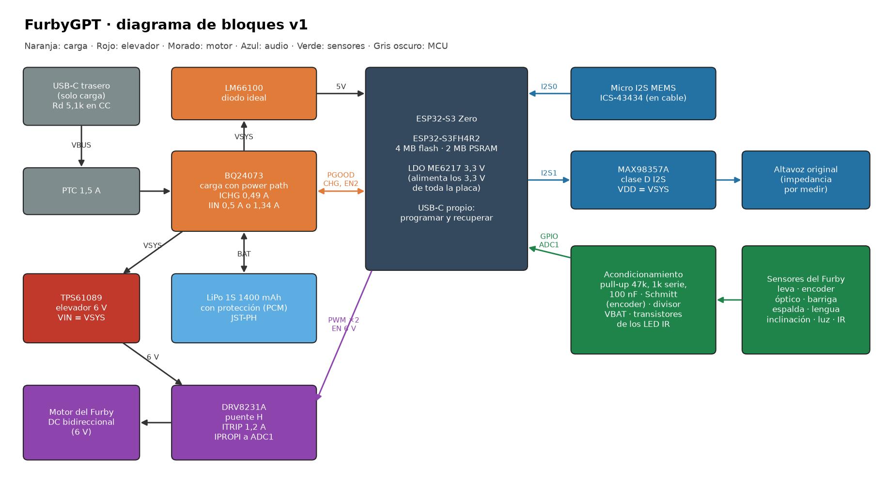
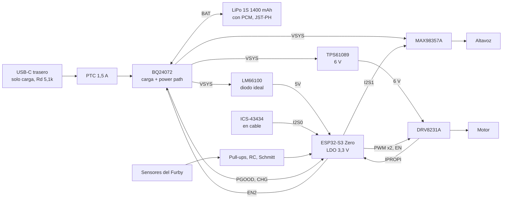
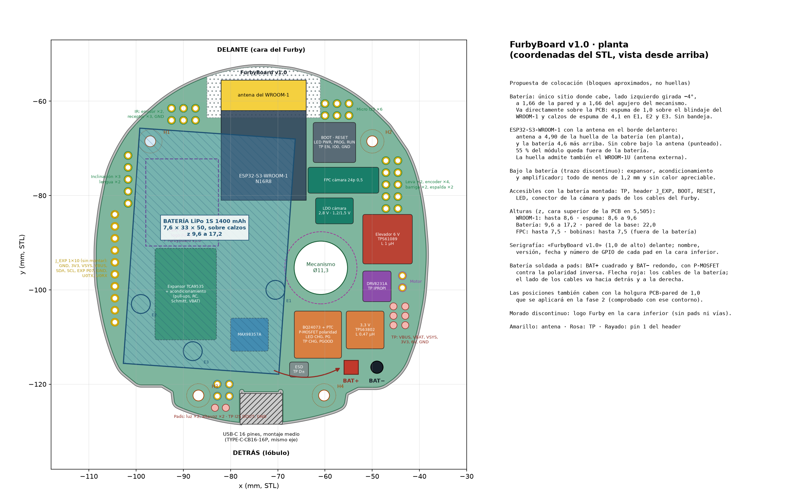

# Arquitectura electrónica v1 del FurbyGPT (fase 1)

Propuesta para aprobar antes del esquemático y el layout (fase 2). Es la electrónica que sustituye a la Raspberry Pi, al HAT WM8960 y al L298N del README, y va sobre la PCB con forma de suelo de este directorio (`NOTAS.md`, `interfaz-base.md`, `geometria.json`).

Convenciones:

- **Verificado:** comprobado en la hoja de datos, el esquema del fabricante, la API de piezas de JLCPCB o la geometría del repo.
- **Estimado:** cálculo o valor típico sin medir.
- **Por medir:** hay que medirlo en el Furby o en el banco.
- Precios en USD por unidad a 1–49 uds, y stock de la API de piezas de JLCPCB del 2026-10-24.

## Resumen

| Bloque | Elección | Por qué |
|--------|----------|---------|
| MCU | **Waveshare ESP32-S3 Zero**, castellated soldado en la cara superior | Requisito. Mismo módulo que el Furbygotchi |
| USB | **USB-C trasero de 6 pines actual, solo carga**. Se programa por OTA (WiFi) y, para el primer flasheo y la recuperación, por el USB-C del propio Zero | **El Zero no saca D+ ni D− a ningún pad** (verificado en su esquema). Alternativa con datos por el conector trasero: sección 7 |
| Carga y power path | **TI BQ24072** (cargador lineal con gestión de ruta y modo suplemento) + **LM66100** (diodo ideal hacia el pin 5V del Zero) | Un solo integrado: prioriza el sistema, completa con la batería los picos que el USB no da y saca PGOOD y CHG. La salida sigue a la batería (VBAT + 0,225 V), así que el LDO del Zero calienta poco |
| Batería | LiPo 1S 1400 mAh, 7,6 × 33 × 50, en una **bandeja impresa elevada** sobre el lado izquierdo | No caben batería y Zero uno al lado del otro (sección 5) |
| Motor | **TPS61089** (elevador a 6 V) + **DRV8231A** (puente H con regulación de corriente y salida IPROPI al ADC) | El TPS61023 del mod de la Game Boy no llega a 6 V (máximo 5,5 V). El DRV8231A limita la corriente de bloqueo y la mide |
| Audio | **MAX98357A** (clase D I2S) en VSYS + micrófono I2S **ICS-43434** en una plaquita con cable | El amplificador no aguanta 6 V (máximo 5,5 V): va en VSYS, no en el elevador. El micro va arriba, en el cuerpo: en el suelo de la base, bajo la batería, oiría muy mal |
| Sensores | Pads pasantes para los cables del Furby, con pull-up, filtro RC y Schmitt en el encoder | |
| Coste | **≈ 7 USD de componentes por placa** y **10 piezas extended (30 USD por pedido)**. Pedido de 5 PCB con 2 montadas: **≈ 62 USD (31 USD por placa)**; con 5 montadas, **≈ 84 USD (17 USD por placa)**. Más el Zero, que se compra aparte | Estimado (sección 3) |

**Riesgo principal:** la batería de 33 × 50 entra con 1,66 mm de margen a la pared y al agujero del mecanismo, y su cara superior queda en z 19,0. Lo que haya del cuerpo del Furby por encima de z 19 o junto al mecanismo no está medido.

## 1. Diagrama de bloques





### Raíles

| Raíl | De dónde sale | Tensión | Qué alimenta |
|------|---------------|---------|--------------|
| VBUS | USB-C trasero, tras el PTC | 5 V | Entrada IN del BQ24072 (OVP a 6,6 V, máximo absoluto 28 V) |
| BAT | Batería, tras su PCM | 3,0–4,2 V | BQ24072 (carga y descarga) y divisor de VBAT |
| VSYS | OUT del BQ24072 | VBAT + 0,225 V con USB (mín. 3,4 V); VBAT − 50 mV sin USB | LM66100, TPS61089, MAX98357A, LED IR |
| 5V_ZERO | Salida del LM66100 al pin 5V del Zero | ≈ VSYS | LDO ME6217 del Zero |
| 3V3 | LDO ME6217C33 del Zero (800 mA) | 3,3 V | ESP32-S3, micro, pull-ups, Schmitt, LED del encoder |
| 6V | TPS61089 | 5,94 V (390k/100k) | Solo el DRV8231A |

**Por qué hay un LM66100 entre VSYS y el pin 5V del Zero (verificado en el esquema de Waveshare):** el pin 5V del Zero está unido directamente al VBUS de su USB-C, sin diodo. Si se enchufa el USB del módulo para programar con la batería puesta, los 5 V del ordenador entrarían en el OUT del BQ24072 y, a través de su FET de batería, cargarían la LiPo sin control. El LM66100 con CE a VOUT se abre cuando su salida supera la entrada en 35 mV (hoja de datos de TI, «VOFF») y bloquea ese camino. Caída: 0,125 Ω × 0,35 A = 44 mV.

## 2. Selección de componentes

### 2.1 Carga y power path: BQ24072 frente a TP4056 + P-MOSFET + Schottky

| | **BQ24072RGTR** (C140288) | TP4056 + AO3401A + SS34 (load sharing) |
|---|---|---|
| Piezas | 1 IC + 6 resistencias + 3 condensadores | 3 IC/discretos + ≈ 8 pasivos |
| Coste de piezas | 1,09 USD (0,71 a 100 uds) | ≈ 0,25 USD |
| Cargo de JLCPCB | 3 USD (extended) | 0 USD (TP4056 C16581 es «preferred»; AO3401A y SS34, básicas) |
| Sistema con USB | Desde VBUS, limitado por ILIM; **modo suplemento**: si la carga pasa del límite de entrada, la batería aporta el resto sin cortes | Todo desde VBUS por el Schottky (0,4 V de caída). Un puerto de 500 mA se cae con el motor |
| Al desenchufar | Conmuta internamente: OUT pasa a VBAT − 50 mV | El P-MOSFET tarda en abrirse: durante unos ms conduce su diodo (0,7 V), y el LDO del Zero baja de 3,3 V |
| Estado | PGOOD (USB presente) y CHG (cargando), en colector abierto | Sin señal de USB presente (hay que añadir un divisor) |
| Protecciones | OVP, temporizadores, NTC (TS), regulación térmica a 125 °C, cortocircuito en OUT | Las del TP4056 |

**Elegido: BQ24072.** Cuesta unos 4 USD más por pedido, pero el modo suplemento es lo que permite mover el motor con un puerto USB de 500 mA. El BQ24073 (C15220, 30 252 en stock, 0,88 USD) es **pin a pin** (mismo encapsulado RGT0016B y mismo pinout, según la figura 7-1 de la hoja de datos) y sirve de segunda fuente. Su OUT es fijo a 4,4 V con USB, así que el LDO del Zero disiparía más (sección 4.4).

Configuración (hoja de datos SLUS810N):

| Pin | Conexión | Resultado |
|-----|----------|-----------|
| ISET | 1,8 kΩ 1 % (C4177, básica) | ICHG = KISET / RISET = 890 / 1800 = **0,494 A** (0,44–0,54 A con KISET de 797 a 975 AΩ). 0,35 C para 1400 mAh |
| ILIM | 1,2 kΩ (C22765, básica) | IIN = 1610 / 1200 = **1,34 A** cuando EN2 = 1 |
| EN1 / EN2 | EN2 = GPIO45 con 100 kΩ a GND. EN1 = la inversa: 100 kΩ a VSYS y un 2N7002 a GND con la puerta en GPIO45 | Con EN2 = 1 y EN1 = 1 el BQ se suspende (tabla de EN1/EN2), así que EN1 tiene que ir al revés que EN2. GPIO45 bajo (arranque, sueño o ESP apagado): EN2 = 0 y EN1 = 1 → **USB500 (475 mA típ.)**, seguro para cualquier puerto. GPIO45 alto: EN2 = 1 y EN1 = 0 → **ILIM, 1,34 A**, solo si el firmware sabe que el cargador es bueno |
| TS | 10 kΩ a GND | Sin NTC (lo indica la hoja de datos para baterías sin termistor). Si la batería trae tercer hilo NTC de 10 k, va aquí |
| TD | GND | Terminación activada |
| TMR | Al aire | Temporizador de 5 h (18 000 s), suficiente para 3,5 h de carga |
| CE | GND | Carga siempre habilitada |
| PGOOD, CHG | 100 kΩ a 3V3 y a GPIO38 / GPIO39 | Colector abierto: no superan 3,3 V |

### 2.2 Motor

**Motor del Furby de 1998.** Es un motor DC de escobillas, bidireccional, que mueve todo (ojos, orejas, boca, cuerpo) a través de una leva. Lo lee un encoder óptico (LED IR + fototransistor a través de un engranaje ranurado) y un interruptor de posición de la leva (fuentes en la sección 10). Iba con 4 pilas AA: de 6,4 V con pilas nuevas a ≈ 4,4 V gastadas.

**Corriente: no hay ninguna medida publicada.** Estimación, por ser un motor del tamaño de los de bandeja de DVD (con los que se ha sustituido en reparaciones): **0,1–0,3 A en marcha y 0,6–1,2 A bloqueado a 6 V (ESTIMADO)**. Hay que medirlo: la resistencia del bobinado con el polímetro, en varias posiciones del eje, da la de bloqueo (I = 6 V / R); y la de marcha, con una fuente limitada a 2 A.

| | Pieza | Datos verificados | Dimensionado |
|---|---|---|---|
| Elevador | **TPS61089RNRR** (C165129, extended, 10 369 en stock, 0,71 USD) | VIN 2,7–12 V, VOUT 4,5–12,6 V, interruptor de 7 A, ILIM = 1 030 000 / RILIM, VREF 1,212 V, fSW con RFREQ, arranque suave de 4 ms, EN | VOUT = 1,212 × (1 + 390k/100k) = **5,94 V**. RILIM 270 kΩ (C22965) → **3,8 A** de pico. RFREQ 150 kΩ (C22807) → ≈ 0,96 MHz a 3,7 V (ecuación 1). Pasar a 5 V es cambiar una resistencia del divisor |
| Bobina | **FHD4020S-1R0MT** (C602028, 0,07 USD), **la misma del mod de la Game Boy** | 1 µH, 4 × 4 × 2 mm, saturación > 6,7 A | Rizado: 3,7 × 0,445 / (1 µH × 0,96 MHz) = 1,7 A p-p. Pico con 1,2 A a la salida y 3,3 V a la entrada: 2,42 + 0,87 = **3,3 A**, por debajo del ILIM (3,8 A) y lejos de la saturación |
| Puente H | **DRV8231ADDAR** (C5218849, extended, 2056 en stock, 1,05 USD). Segunda fuente: DRV8231ADSGR (C5139865, 8895 en stock) | VM 4,5–33 V, 3,7 A de pico, RDS(on) 0,3 + 0,3 Ω, IPROPI = 1500 µA/A, regulación de corriente con VREF, entradas con pull-down y reposo automático con IN1 = IN2 = 0 | RIPROPI 1,5 kΩ → 2,25 V por amperio en el ADC. VREF = 3,3 × 10k / (2,2k + 10k) = 2,70 V → **ITRIP = 2,70 / (1,5k × 1500 µA/A) = 1,2 A** |

**Por qué el DRV8231A y no el DRV8837 (C39159, 0,20 USD).** Con el motor sin medir, la regulación de corriente:

- protege el engranaje, que en el Furby de 1998 es el punto débil conocido;
- evita que el PCM de la batería corte por sobrecorriente (sección 4);
- y permite detectar el bloqueo por corriente, además de por el encoder.

El DRV8837 solo tiene protección por sobrecorriente a 1,9–3,5 A, sin regulación. Si el motor medido bloquea a menos de 0,8 A, se puede volver al DRV8837 en la v1.1. Disipación del DRV8231A con 1,2 A: 0,6 Ω × 1,2² = 0,86 W → +37 °C (RθJA de 42,8 °C/W). El firmware tiene que cortar a los 200 ms de bloqueo.

**¿El elevador puede alimentar también el amplificador?** No. El MAX98357A admite 2,5–5,5 V de VDD, así que 6 V lo saca de rango. Además, el raíl del motor lleva ruido de conmutación y de escobillas. El amplificador va en VSYS (3,4–4,4 V): da 0,77 W en 8 Ω al 1 % de THD con 3,7 V (hoja de datos), de sobra para el altavoz original.

### 2.3 Audio

**Amplificador: MAX98357AETE+T** (C910544, extended, 21 765 en stock, 1,32 USD).

- I2S estándar de 8 a 96 kHz, sin MCLK, 2,4 mA en reposo y 0,6 µA apagado.
- Ganancia de 9 dB con GAIN_SLOT al aire.
- SD_MODE a un GPIO: alto (3,3 V) = canal izquierdo; bajo = apagado (tabla 5 de la hoja de datos).
- Alternativa más barata: NS4168 (C910588, 0,71 USD), peor documentado.

**Altavoz original: impedancia y potencia por medir.** Con 8 Ω y 3,7 V puede recibir 0,77 W. Si es de 0,25 W, el firmware limita el volumen digital, que es lo que lo protege.

**Micrófono: ICS-43434** (C5656610, extended, 3981 en stock, 4,60 USD).

- Hoja de datos verificada: en modo de bajo consumo trabaja de 6,25 a 18,75 kHz, con 230 µA y 64 dBA de SNR. En alto rendimiento, de 23 a 51,6 kHz.
- **16 kHz cae en el modo de bajo consumo**, y es justo la frecuencia que piden WakeNet (ESP-SR) y microWakeWord: mono, 16 bit, 16 kHz. También sirve para enviar el audio a la nube.
- Va en una plaquita de 6 pines (VDD, GND, SCK, WS, SD, L/R) con cable de 15 cm como máximo, junto al agujero del micro original del cuerpo. En la PCB base, encerrado en el suelo, debajo de la bandeja y con pelo alrededor, oiría muy mal.
- En la PCB se dejan 6 pads y resistencias serie de 33 Ω en SCK y WS. La plaquita entra en el mismo pedido como diseño aparte, o se usa un módulo comercial INMP441/ICS-43434.

**Dos buses I2S:** I2S0 en recepción (micro) e I2S1 en emisión (amplificador). Cuestan 2 GPIO más que compartir BCLK y WS, pero:

- el micro sigue a 16 kHz mientras el altavoz reproduce el TTS a 22,05 o 24 kHz, sin remuestrear;
- y el micro sigue abierto mientras habla el Furby, que es lo que necesita la cancelación de eco (AEC) de ESP-SR.

**Palabra de activación.**

- ESP-SR (WakeNet) solo trae palabras predefinidas («Hi ESP», «Alexa»…). Una propia («Hey Furby») la entrena Espressif como servicio de pago.
- microWakeWord (TFLite Micro, el de ESPHome) corre en el ESP32-S3 y se puede entrenar con palabras propias.
- Picovoice Porcupine, el del README actual, no está verificado en ESP32-S3.
- Las dos primeras necesitan PSRAM, y el Zero trae 2 MB.

**Riesgo: 4 MB de flash.** Hay que meter dos particiones OTA (≈ 1,5 MB cada una), el modelo de la palabra de activación y NVS. No está comprobado que quepan: se mide al compilar el primer firmware.

### 2.4 Sensores del Furby de 1998

| Sensor | Qué es | Acondicionamiento | Pads | Estado |
|--------|--------|-------------------|------|--------|
| Leva (posición de inicio) | Interruptor mecánico | 47 kΩ a 3V3, 1 kΩ en serie y 100 nF (τ = 4,7 ms) | 2 (SEÑAL, GND) | Verificado que existe (sección 10) |
| Encoder del engranaje | LED IR + fototransistor, ranuras en el engranaje | LED: 3V3 → 220 Ω → LED → AO3400A con la puerta en EN_6V (≈ 9,5 mA, solo con el motor en marcha). Fototransistor: 10 kΩ a 3V3 (ajustable de 4,7 a 47 kΩ) → **74LVC1G17** (Schmitt) → PCNT | 4 (ánodo LED, cátodo LED, colector, emisor) | Verificado que existe; las resistencias originales, por medir |
| Barriga, espalda, lengua | Interruptores normalmente abiertos | Como la leva. GPIO RTC: despiertan del sueño profundo | 2 cada uno | Verificado (NA en barriga y lengua) |
| Inclinación o vuelco | Interruptor de bola | Como la leva, con 47 kΩ: si está cerrado en reposo, gasta 70 µA y no 330 | 3 (COMÚN, A, B) | **Supuesto** que tiene 2 contactos (inclinado y bocabajo). Si tiene uno, sobra el pad B y su GPIO |
| Luz | Fotorresistencia en la frente | Divisor con 47 kΩ a GND y 100 nF → ADC1 | 2 | **Supuesto** que es una LDR (un hacker la describe así). Si es un fototransistor, mismo circuito con otra resistencia |
| IR (emisor) | LED IR en la frente | VSYS → 22 Ω (0805) → LED → AO3400A ← GPIO43 (portadora por RMT). ≈ 100 mA en pulsos | 2 | Verificado que existe |
| IR (receptor) | Fotosensor IR en la frente | Pads para un receptor demodulador de 38 kHz de 3 pines (tipo VS1838B) que sustituya al original: 3V3, GND y salida → GPIO44 | 3 | **Supuesto**: el original va al coprocesador y no está claro que sea demodulador. Prioridad baja |

Todos los pads son pasantes de Ø1,0 mm en paso de 2,54 mm. El cable atraviesa la placa y se suelda arriba, lo que aguanta mejor los tirones que una pad SMD. Por debajo, el hilo se corta a ras: solo hay 2 mm hasta el suelo.

### 2.5 Resto

| Ref. | Pieza | LCSC | Tipo | Notas |
|------|-------|------|------|-------|
| J1 | USB-C HRO TYPE-C-31-M-28A (6 pines, montaje medio) | C2848622 | Extended | **Sin cambios**: el eje y el corte de la base se mantienen |
| F1 | PTC 1,5 A / 16 V, 1206 (BSMD1206-150-16V) | C883133 | Extended | Protege el VBUS de cortocircuitos aguas abajo |
| J2 | JST-PH 2 pines SMD (S2B-PH-SM4-TB) | C295747 | Extended | **La polaridad de los JST-PH de las LiPo cambia según el vendedor**: comprobar con el polímetro antes de enchufar (dudas, punto 4) |
| D1 | LED verde 0805 (KT-0805G) en CHG | C2297 | Básica | 3V3 → 1 kΩ → LED → CHG, con 100 kΩ en paralelo. Con CHG en alta impedancia el LED queda a 0 V y el GPIO lee 3,3 V |
| Q1, Q2 | AO3400A | C20917 | Básica | LED IR y LED del encoder |
| Q3 | 2N7002 | C8545 | Básica | Inversor de EN1 del BQ24072 |

No se pone protección contra la inversión de polaridad de la batería. Un P-MOSFET en serie con la batería añadiría 0,1–0,2 V de caída con el motor bloqueado (2,4 A), justo donde el margen es menor.

## 3. BOM preliminar y coste

API de piezas de JLCPCB del 2026-10-24. Precio por unidad en el tramo de 1–49 uds.

| Ref. | Pieza | LCSC | Tipo | Stock | USD/ud | Cant. |
|------|-------|------|------|-------|--------|-------|
| U1 | BQ24072RGTR | C140288 | Extended | 2499 | 1,094 | 1 |
| U2 | LM66100DCKR | C2869734 | Extended | 19 243 | 0,224 | 1 |
| U3 | TPS61089RNRR | C165129 | Extended | 10 369 | 0,715 | 1 |
| L1 | FHD4020S-1R0MT | C602028 | Extended | 13 988 | 0,074 | 1 |
| U4 | DRV8231ADDAR | C5218849 | Extended | 2056 | 1,055 | 1 |
| U5 | MAX98357AETE+T | C910544 | Extended | 21 765 | 1,323 | 1 |
| U6 | SN74LVC1G17DBVR (TI) | C7836 | Extended | 9943 | 0,155 | 1 |
| J1 | TYPE-C-31-M-28A | C2848622 | Extended | 15 510 | 0,126 | 1 |
| J2 | S2B-PH-SM4-TB(LF)(SN) | C295747 | Extended | 27 506 | 0,223 | 1 |
| F1 | BSMD1206-150-16V | C883133 | Extended | 46 173 | 0,068 | 1 |
| Q1, Q2 | AO3400A | C20917 | Básica | 1 227 194 | 0,089 | 2 |
| Q3 | 2N7002 | C8545 | Básica | 2 911 361 | 0,016 | 1 |
| D1 | KT-0805G | C2297 | Básica | 2 447 313 | 0,016 | 1 |
| C | 22 µF 25 V X5R 0805 (CL21A226MAQNNNE) | C45783 | Básica | 4 309 410 | 0,191 | 7 |
| C | 10 µF 10 V X5R 0603 (CL10A106KP8NNNC) | C19702 | Básica | 13 172 933 | 0,027 | 4 |
| C | 1 µF 50 V X5R 0603 | C15849 | Básica | 13 890 693 | 0,015 | 3 |
| C | 100 nF 50 V X7R 0603 | C14663 | Básica | 44 646 550 | 0,008 | 16 |
| R | 0603 1 % UNI-ROYAL: 5,1k (C23186), 1,8k (C4177), 1,2k (C22765), 1,5k (C22843), 2,2k (C4190), 10k (C25804), 100k (C25803), 47k (C25819), 1k (C21190), 220 Ω (C22962), 33 Ω (C23140), 150k (C22807) | | Básicas | > 0,5 M cada una | ≈ 0,002 | ≈ 45 |
| R | 390k (C23150) y 270k (C22965) | | Extended «preferred», sin cargo | 291 717 / 278 304 | 0,002 | 2 |
| R | 22 Ω 0805 (LED IR) | En la fase 2 | Básica | | ≈ 0,005 | 1 |
| — | ESP32-S3 Zero (Waveshare) | No está en JLCPCB | Se compra aparte | | ≈ 5–6 € | 1 |
| — | ICS-43434 en la plaquita del micro | C5656610 | Extended | 3981 | 4,600 | 1 (otro diseño) |

- **Componentes por placa: ≈ 7,0 USD** sin el Zero ni el micro.
- **Piezas extended con cargo: 10 → 30 USD por pedido** (3 USD por referencia; las «preferred» no pagan).

| Pedido en JLCPCB (estimado) | 2 montadas de 5 | 5 montadas de 5 |
|-----------------------------|-----------------|-----------------|
| PCB de 2 capas, 70 × 76, 5 uds | ≈ 4 | ≈ 4 |
| Montaje económico: preparación + plantilla | 8 + 1,5 | 8 + 1,5 |
| Cargos de extended | 30 | 30 |
| Componentes, con mínimos de compra y merma (×1,35 y ×1,15) | ≈ 19 | ≈ 40 |
| **Total sin envío ni impuestos** | **≈ 62 USD (31 por placa)** | **≈ 84 USD (17 por placa)** |

Para bajar el cargo de las extended:

- montar a mano J2, F1 y U6 (−9 USD);
- o pasar a TP4056 + load sharing (−3 USD), perdiendo el modo suplemento.

Las tres están descartadas para la v1: el BQ24072 es el que deja mover el motor con un puerto de 500 mA.

**Lecciones del mod de la Game Boy que se aplican en la fase 2:**

- el Gerber y el CPL, con el mismo origen;
- en la BOM, una línea por valor, con las referencias juntas;
- rotaciones del CPL revisadas en el visor de JLCPCB (QFN y SOT).

## 4. Presupuesto de potencia

### 4.1 Consumos por bloque

| Bloque | Reposo | Activo típico | Pico | Fuente |
|--------|--------|---------------|------|--------|
| ESP32-S3, sueño profundo | 7–8 µA | | | Hoja de datos, tabla 5-10 |
| ESP32-S3 a 240 MHz, sin radio | | 66–81 mA (dos núcleos) | 108 mA | Hoja de datos, tabla 5-9 (sin PSRAM: con ella, algo más) |
| ESP32-S3, WiFi TX 802.11b a 21 dBm | | | **340 mA** | Hoja de datos, tabla 5-7 |
| ESP32-S3, WiFi RX | | 88–91 mA | | Hoja de datos, tabla 5-7 |
| LDO ME6217 + LED WS2812 del Zero | ≈ 0,1 + 0,6–1 mA | | | **Estimado**: el WS2812 no está documentado por Waveshare |
| Micro ICS-43434 (16 kHz) | 12 µA (sin reloj) | 0,23 mA | | Hoja de datos |
| MAX98357A | 0,6 µA (apagado) | 2,4 mA + audio | 0,77 W en 8 Ω → **0,25 A** de VSYS | Hoja de datos |
| Motor en marcha, 6 V | | 0,3 A × 6 V → **0,54 A** de batería a 3,7 V | | **Estimado** (η 0,9) |
| Motor bloqueado, ITRIP 1,2 A | | | 1,2 A × 6 V → **2,16 A** a 3,7 V; **2,42 A** a 3,3 V | Calculado |
| BQ24072, LM66100, DRV, TPS, divisor VBAT, PCM | ≈ 6,5 + 0,2 + 1 + 1 + 21 + 5 µA | | | Hojas de datos; el PCM, estimado |

### 4.2 Modos y autonomía con 1400 mAh

Se cuenta con el 85 % de la capacidad. El regulador del Zero es lineal, así que la corriente de la batería es la misma que la de 3,3 V.

| Modo | Corriente de la batería | Autonomía |
|------|-------------------------|-----------|
| Dormido (sueño profundo; despierta al tocar la barriga, la espalda o la lengua, o al enchufar el USB) | ≈ 0,8–1,2 mA (≈ 0,2 mA sin el WS2812) | **≈ 40–60 días** (≈ 8 meses quitando el WS2812) |
| Escuchando la palabra de activación (240 MHz, WiFi asociado con modem sleep) | ≈ 80–110 mA | **≈ 11–15 h** |
| Conversación (WiFi transmitiendo y recibiendo, audio a volumen medio, motor a ratos) | ≈ 200–350 mA de media | **≈ 3,5–6 h** hablando sin parar |
| **Pico simultáneo** (motor bloqueado + TX WiFi + amplificador a tope) | 2,42 + 0,34 + 0,25 + 0,03 = **3,0 A** a 3,3 V; 2,75 A a 3,7 V | |

**Conclusión:** escuchando todo el tiempo, dura un día de uso; para que dure semanas tiene que dormirse y despertar con un toque. Es una decisión de producto (dudas, punto 9).

**El pico de 3,0 A puede disparar el PCM de la batería.** Las placas de protección típicas (DW01 + 8205A) cortan hacia 3 A. Por eso:

- ITRIP del motor a 1,2 A (y no más);
- y en el firmware: rampa de PWM de 50 ms al arrancar el motor, corte a los 200 ms de bloqueo y volumen no máximo mientras el motor arranca.

Falta el dato de sobrecorriente del PCM de la batería (dudas, punto 4).

### 4.3 ¿Basta un USB de 500 mA o hace falta uno de 1,5–3 A?

| Fuente | Qué pasa |
|--------|----------|
| **Puerto de ordenador, 500 mA** (BQ en USB500, 475 mA) | Dormido, escuchando y conversación: sí, y sobra para cargar despacio. Motor y picos: **la batería completa la diferencia (modo suplemento)**. Con la batería por debajo de ≈ 3,4 V o sin batería, el firmware no debe mover el motor |
| **Cargador de 1,5–3 A** (EN2 = 1, IIN 1,34 A) | Todo menos el pico simultáneo. Con el motor bloqueado: 7,2 W / (VSYS 3,9 V × 0,9) = 2,05 A + 0,34 + 0,25 = 2,6 A en VSYS; el USB da 1,34 y la batería 1,3 |

**El BQ24072 nunca toma más de 1,5 A del USB**, así que un cargador de 3 A no aporta más que uno de 1,5 A.

**Detección de cortocircuito en modo suplemento** (VBAT − VOUT > 200 mV mínimo, hoja de datos «VO(SC2)»): el FET de batería tiene 50 mΩ típicos y 100 mΩ máximos. En USB500 con el motor bloqueado, la batería aporta ≈ 2,1 A → 105–210 mV, **en el límite**. Por eso el firmware sube a 1,34 A en cuanto ve un cargador bueno, y la prueba de bring-up incluye «motor bloqueado con USB de 500 mA».

### 4.4 Temperaturas

| Pieza | Peor caso | Disipación | ΔT | Fuente de RθJA |
|-------|-----------|------------|----|----------------|
| BQ24072 cargando | VIN 5 V, VBAT 3,6 V, 0,494 A + 0,1 A de sistema a VOUT 3,83 V | (5 − 3,6) × 0,494 + (5 − 3,83) × 0,1 = 0,81 W | +36 °C (44,5 °C/W) | Hoja de datos |
| ME6217 del Zero, con USB | VSYS 4,4 V (BQ24073) frente a 3,9 V (BQ24072), 0,2 A de media en conversación | 0,22 W frente a 0,12 W | +55 °C frente a +30 °C (≈ 250 °C/W, SOT-23-5) | **Estimado**: es la razón para elegir el BQ24072 |
| TPS61089 | Motor bloqueado, 7,2 W de salida, η 0,88 | ≈ 0,5 W en el IC | +27 °C (53,4 °C/W) | Hoja de datos |
| DRV8231A | ITRIP 1,2 A | 0,86 W | +37 °C durante ≤ 200 ms | Hoja de datos |
| LM66100 | 0,35 A | 15 mW | +3 °C | Hoja de datos |

Con 40 °C dentro del Furby, todas quedan por debajo de los 110 °C de Tj. El cargador y el elevador van fuera de la batería, como en el render.

## 5. Colocación sobre el contorno real



`scripts/render_arquitectura.py` comprueba la colocación sobre `geometria.json` antes de dibujar: si algo no cabe, sale con código 1. Comprueba:

- PCB, exclusión del mecanismo, cabezas de los tornillos, USB-C y zona sin cobre de la antena;
- que los bloques no se solapen;
- que la batería quede dentro de la pared y a más de 1,5 mm del agujero.

Hecho con la geometría actual: la batería queda a **1,66** de la pared y del agujero, y la antena del Zero a **4,05** por fuera de la huella de la batería.

**La batería y el Zero no caben uno al lado del otro.** Se probó una búsqueda exhaustiva en posición y giro (pasos de 0,25–1 mm y de 1–15°):

- la batería de 33 × 50 solo cabe en el lado izquierdo, ligeramente girada (−4°), entre la pared y el agujero del mecanismo;
- con 1 mm de margen al agujero, no queda ningún hueco de 18 × 23,5 para el Zero fuera de ella;
- sin margen, solo hay posiciones con 0,2–0,3 mm de holgura, imposibles con las tolerancias de la batería.

Por eso **la batería va en una bandeja impresa por encima del Zero**.

| Elemento | Dónde | Por qué |
|----------|-------|---------|
| Batería | Lado izquierdo, centro en (−84,5; −91,8), girada −4°, sobre la bandeja | El único sitio donde cabe |
| ESP32-S3 Zero | x −87 a −69, y −80 a −56,5; castellated en la cara superior | La antena (extremo delantero, ≈ 6 mm) queda fuera de la batería, mirando al frente; el 44 % del módulo asoma. Debajo de la antena, en nuestra PCB: sin cobre en ninguna capa (x −89 a −67, y −63,5 al borde). Su USB-C queda bajo la bandeja |
| Carga y power path (BQ24072, LM66100, PTC) | x −66,5 a −55, y −114,5 a −104,5 | Junto al USB-C, debajo del mecanismo, fuera de la batería (calienta) |
| JST-PH de la batería | x −52,5 a −44,5, y −113,5 a −105,5 | Junto al cargador. El cable de la batería sale por su lado corto trasero |
| Elevador 6 V | x −52 a −41,5, y −94,5 a −84 | A la derecha del mecanismo, cerca del motor. Bobina de 2 mm, fuera de la bandeja |
| Puente H y pads del motor | x −52 a −46, y −102,5 a −96 | Junto al mecanismo, que es por donde bajan los cables del motor y del encoder |
| Amplificador y pads del altavoz | x −64,5 a −55,5, y −82,5 a −74 | Entre la batería, H2 y el mecanismo |
| Pads delanteros (15) | 5 × 3 a la derecha de la antena | Micro, barriga, espalda, lengua y luz: cables que bajan por delante |
| Pads derechos (8) | 2 × 4 junto al borde derecho | Leva, encoder y LED IR |
| Pads izquierdos (6) | Columna junto al borde izquierdo | Inclinación y receptor IR |
| Acondicionamiento de sensores | Bajo la bandeja, x −97 a −74, y −110 a −88 | Solo pasivos 0603 y el Schmitt en SOT-23-5: menos de 1,1 mm |
| Apoyos de la bandeja | H1 y H3 atornillados (M2 × 10 en vez de M2 × 4, misma rosca en el separador); A1 (−72; −108) y A2 (−99; −103), círculos de Ø4 sin componentes | Coordinar con el 3d-architect: la bandeja es una pieza nueva |

Debajo de la bandeja no va nada que caliente ni piezas de más de 1,1 mm, salvo el propio Zero.

**El Zero queda entre la PCB y la bandeja.** Su LDO y el ESP32 disipan 0,1–0,3 W con 0,6 mm de aire hasta la bandeja, y la batería está encima. En la fase 2, la bandeja lleva una ventana sobre el ESP32 y su LDO.

## 6. Alturas

| Elemento | z inferior | z superior | Notas |
|----------|------------|------------|-------|
| Suelo de la base | | 1,905 | |
| PCB | 3,905 | 5,505 | Separadores de 2,0 |
| USB-C trasero | | 7,085 | Sin cambios |
| Bobina del elevador | 5,505 | 7,5 | 4 × 4 × 2 |
| ESP32-S3 Zero con su USB-C | 5,505 | **10,1** | PCB de 1,0 + USB-C de 3,6 (medidas del Furbygotchi) |
| JST-PH SMD | 5,505 | ≈ 11,0 | **Por confirmar** en el plano de JST |
| Bandeja | 10,6 | 11,4 | 0,5 de aire sobre el Zero y 0,8 de suelo |
| **Batería** | **11,4** | **19,0** | 7,6 de grosor |
| Pared de la base | | **22,0** | Quedan **3,0** sobre la batería |
| Cuerpo del Furby | ? | ? | **RIESGO: sin medir.** En el Furby original esta zona era el portapilas de 4 AA (≥ 15 mm de alto), así que es probable que esté libre. Hay que comprobar que nada del cuerpo baja de z 19,5 en la mitad izquierda ni junto al mecanismo |

Las paredes de la base son verticales hasta z ≈ 16: se midió en el STL modificado a z 10, 12 y 16, con el mismo hueco que el suelo. A z 20 el hueco es 1,5 mm mayor por lado. La batería tiene, por tanto, la misma planta disponible que la PCB.

## 7. USB: el Zero no saca D+ ni D−

**Verificado en el esquema de Waveshare (ESP32-S3-Zero-Sch.pdf):**

- GPIO19 y GPIO20 van solo a su USB-C, a través de R7 y R8 (22 Ω);
- en el conector de 18 pines castellated (P15) están 5V, GND, 3V3, GPIO1–13, GPIO44 y GPIO43 (este, con 499 Ω en serie);
- las pads inferiores son GPIO14–18, GPIO38–42 y GPIO45;
- GPIO47 y GPIO48 no están conectados.

| Opción | Programar sin abrir | Cambios | Coste | Veredicto |
|--------|---------------------|---------|-------|-----------|
| **A. Zero + USB-C trasero de 6 pines (solo carga) + OTA por WiFi** con dos particiones y vuelta atrás automática. El USB del Zero, para el primer flasheo y la recuperación, quitando la bandeja | Sí, por WiFi; por cable no | Ninguno: ni el conector ni la base | 0 | **Recomendada para la v1**: cumple el requisito del Zero y no toca la base |
| B. Zero + soldar hilos a R7 y R8 del módulo y llevarlos al USB-C trasero de 16 pines | Sí | Hilos de 0,1 mm a resistencias 0402 del módulo, y un tramo sin terminar en paralelo con su conector | ≈ 0 | Descartada: frágil, y no está verificado dónde están R7 y R8 en la placa del Zero |
| C. ESP32-S3 SuperMini | No verificado | | | Descartada: los pinouts publicados sacan GPIO1–13, 43 y 44, no GPIO19/20, y los clones no tienen documentación fiable |
| D. **ESP32-S3-MINI-1-N4R2** (C3013941, extended, 2782 en stock, 5,00 USD; 3,64 a 100 uds), soldado por JLCPCB, con USB-C trasero de 16 pines | Sí, por cable | Módulo de 15,4 × 20,5 × 2,4 en vez del Zero: LDO propio (ME6217C33M5G, C427602) y antena en el borde de la PCB. Conector de 16 pines | +≈ 2 USD por placa, sin el Zero | **La alternativa** si programar por cable sin abrir es imprescindible: es el mismo chip (ESP32-S3FH4R2) y el mismo firmware. Saca todos los GPIO, sin soldar pads inferiores a mano, y con 2,4 de alto la bandeja baja 2,2 mm |

**Si se elige la D, el conector de 16 pines:**

- **HRO TYPE-C-31-M-12** (C165948, 327 675 en stock, 0,19 USD): es de montaje en superficie. El eje sube 1,63 mm, a z 7,135 (ya calculado en `geometria.json`, `alturas.z_centro_top_mount`). El corte de la base sube lo mismo y la ranura de la PCB desaparece: hay que regenerar `geometria.json` y la base.
- De montaje medio con 16 pines: KH-TYPE-C-CB.W-16P (C2688792, 922 en stock) o TYPE-C-CB16-16P (C42418806, 1200 en stock). Mantendrían el eje si su plano lo confirma para PCB de 1,6. Stock bajo y plano sin revisar.

## 8. Mapa de pines del ESP32-S3 Zero

Según el esquema de Waveshare: el orden físico P15 va del 1 (GPIO43) al 18 (5V). Las pads inferiores no tienen cotas publicadas en el wiki: hay que medirlas en el módulo para hacer la huella en la fase 2.

| GPIO | Dónde | Función | Notas |
|------|-------|---------|-------|
| 1 | Castellated | VBAT (ADC1_CH0) | Divisor 100k/100k + 100 nF, como en el Furbygotchi |
| 2 | Castellated | Luz (ADC1_CH1) | 47 kΩ a GND + 100 nF |
| 3 | Castellated | IPROPI del motor (ADC1_CH2) | **Strapping** (fuente de JTAG): se ignora salvo que se queme el eFuse STRAP_JTAG_SEL. RIPROPI (1,5 kΩ a GND) lo deja a nivel bajo al arrancar, que también es válido |
| 4 | Castellated | MOT_IN1 (PWM, LEDC) | Pull-down interno del DRV: el motor está parado al arrancar |
| 5 | Castellated | MOT_IN2 (PWM, LEDC) | |
| 6 | Castellated | Encoder (PCNT) | Tras el Schmitt |
| 7 | Castellated | Leva (inicio) | |
| 8 | Castellated | I2S0 SCK del micro | 33 Ω en serie |
| 9 | Castellated | I2S0 WS del micro | 33 Ω en serie |
| 10 | Castellated | I2S0 SD del micro | |
| 11 | Castellated | I2S1 BCLK del amplificador | |
| 12 | Castellated | I2S1 LRCLK del amplificador | |
| 13 | Castellated | I2S1 DIN del amplificador | |
| 43 | Castellated (TX) | Emisor IR (RMT → AO3400A) | El ROM lo usa para el log al arrancar: el LED IR parpadea un instante, sin consecuencias. 499 Ω en serie en el módulo |
| 44 | Castellated (RX) | Receptor IR (RMT RX) | Entrada |
| 14 | Pad inferior | Barriga | RTC: despierta del sueño profundo (ext1) |
| 15 | Pad inferior | Espalda | RTC |
| 16 | Pad inferior | Lengua | RTC |
| 17 | Pad inferior | Inclinación A | RTC |
| 18 | Pad inferior | Inclinación B | RTC. Libre si el interruptor tiene un solo contacto |
| 38 | Pad inferior | USB presente (PGOOD) | |
| 39 | Pad inferior | Cargando (CHG) | Con el LED D1 |
| 40 | Pad inferior | EN_6V: EN del TPS61089 y LED del encoder | 100 kΩ a GND: elevador apagado al arrancar |
| 41 | Pad inferior | **Libre** | Reserva: segundo micro, alimentación conmutada del micro… |
| 42 | Pad inferior | SD_MODE del MAX98357A | Alto = canal izquierdo; bajo = apagado (pull-down interno de 100 kΩ) |
| 45 | Pad inferior | EN2 del BQ24072 y, invertido con el 2N7002, EN1 (límite de entrada de 1,34 A) | **Strapping VDD_SPI: tiene que estar a nivel bajo al arrancar** (flash a 3,3 V). Solo 100 kΩ a GND; nunca un pull-up |

**No se pueden usar:**

- GPIO0: botón BOOT del módulo, sin pad;
- GPIO19 y GPIO20: USB del módulo;
- GPIO21: WS2812 del módulo;
- GPIO26–37: flash y PSRAM internas; Waveshare marca GPIO33–37 como reservados;
- GPIO46: strapping, sin pad;
- GPIO47 y GPIO48: sin conectar.

**ADC:** solo ADC1 (GPIO1–10) funciona con el WiFi encendido. Por eso VBAT, luz e IPROPI van en GPIO1–3.

**Balance:** 26 GPIO accesibles, 25 usados y 1 libre. No hace falta un expansor.

- Lo imprescindible (motor, encoder, leva, audio, VBAT, luz, IR) va en los **15 castellated**, que se sueldan a mano sin problema.
- Lo que va en las **11 pads inferiores** (interruptores táctiles, inclinación y estado de carga) necesita soldar el módulo con pasta y placa caliente o aire. La fase 2 deja una vía de Ø0,6 en cada pad para poder soldarlo desde abajo.
- Si las pads inferiores fallan, el Furby habla y se mueve, pero no siente las caricias.
- Plan B sin pads inferiores: un expansor I2C (PCA9557 o similar) en GPIO43/44, a cambio del IR.

## 9. Dudas abiertas

| # | Duda | Recomendación |
|---|------|---------------|
| 1 | **USB con datos.** El Zero no saca D+ ni D−. ¿Basta con programar por OTA (y por el USB del módulo quitando la bandeja), o hace falta programar por cable sin abrir? | **OTA (opción A)** para la v1. Si el cable es imprescindible, la opción D (ESP32-S3-MINI-1-N4R2 montado por JLCPCB) en lugar del Zero |
| 2 | **Altura sobre la base.** La batería llega a z 19,0 y la pared a 22,0. ¿Qué hay del cuerpo del Furby por debajo de z 19,5 en la mitad izquierda? | Medirlo con el Furby abierto. Si no hay sitio: batería de ≈ 1000 mAh y 30 × 40, que cabe plana junto al Zero sin bandeja (comprobado con la misma búsqueda), y −30 % de autonomía |
| 3 | **Mecanismo.** La batería queda a 1,66 mm del agujero Ø11,3. ¿Qué se mueve por encima de la PCB alrededor del agujero? (Su posición también es un supuesto, en `NOTAS.md`) | Medir el centro y el diámetro del agujero y la envolvente del mecanismo por encima. Con más de 1 mm de holgura, sigue la propuesta |
| 4 | **Batería.** ¿Los 50 mm incluyen el PCM? ¿Por qué lado salen los cables? ¿Qué polaridad tiene el JST? ¿A cuánto corta el PCM por sobrecorriente? | Medir con el calibre y mirar la ficha del vendedor. Con un PCM de menos de 3 A, bajar ITRIP a 0,9 A |
| 5 | **Motor.** Corriente de marcha y de bloqueo | Medir la resistencia del bobinado (I_bloqueo ≈ 6 V / R) y la corriente de marcha a 6 V con fuente limitada. Con eso se ajustan ITRIP (VREF) y se decide entre DRV8231A y DRV8837 |
| 6 | **¿6 V o 5 V para el motor?** Con pilas, el Furby funcionaba de 6,4 a ≈ 4,4 V | 6 V (requisito). Bajarlo a 5 V es cambiar una resistencia si hace mucho ruido o fuerza los engranajes |
| 7 | **Altavoz.** Impedancia y potencia | Medir la resistencia en continua. El firmware limita el volumen según la potencia |
| 8 | **Micrófono.** ¿Dónde estaba el original y cuánto cable hace falta? | Plaquita con ICS-43434 junto al agujero original del cuerpo, con 15 cm de cable como máximo |
| 9 | **Escuchando siempre o dormido.** Escuchando la palabra de activación dura ≈ 11–15 h; dormido y despertando con un toque, semanas | Por defecto, dormido y despertar al tocar la barriga o la espalda, con la escucha continua solo enchufado. Es decisión de producto |
| 10 | **Palabra de activación.** ESP-SR solo trae palabras predefinidas; una propia la entrena Espressif con coste | microWakeWord con palabra propia; «Hi ESP» de ESP-SR para la primera prueba |
| 11 | **Sensores.** ¿La bola de inclinación tiene uno o dos contactos? ¿La luz es una LDR o un fototransistor? ¿El receptor IR es un fotodiodo o un demodulador? | Al abrirlo, fotografiar cada sensor y medirlo con el polímetro antes de la fase 2. Los pads ya tienen 3 contactos donde hay dudas |
| 12 | **WS2812 del Zero.** Gasta ≈ 0,6–1 mA siempre (estimado) | Si importa la autonomía dormido, desoldarlo: el estado se ve por WiFi |
| 13 | **Bandeja de la batería.** Pieza nueva | Encargarla al 3d-architect con esta planta: atornillada en H1 y H3 con M2 × 10, apoyada en A1 y A2, con ventana sobre el ESP32 del Zero |

## 10. Fuentes

- Waveshare, [ESP32-S3-Zero](https://www.waveshare.com/wiki/ESP32-S3-Zero) y su esquema (ESP32-S3-Zero-Sch.pdf): pines, pads inferiores, USB solo en el conector, LDO ME6217C33M5G y entrada de 3,7 a 6 V en el pin 5V.
- Espressif, ESP32-S3 Series Datasheet v2.2, tablas 5-7, 5-9 y 5-10 (consumos).
- TI: BQ2407x (SLUS810N), TPS61089 (SLVSD38C), DRV8231A, LM66100 y DRV8837. Maxim/ADI: MAX98357A/B. TDK InvenSense: ICS-43434.
- Furby de 1998: [Sundberg-Ferar](https://sundbergferar.com/furby-product-teardown-why-embedded-systems-engineering-and-human-centered-design-go-hand-in-hand/) (un motor bidireccional, LED + fototransistor y engranaje ranurado); [element14, Upcycle It](https://community.element14.com/challenges-projects/design-challenges/upcycleit/b/blog/posts/upcycle-it-interactive-race-car-driver---furby-hacking) (pulsos del sensor óptico e interruptor de inicio); [Official Furby Wiki, Tilt Sensor Maintenance](https://official-furby.fandom.com/wiki/Furby_(1998)/Tilt_Sensor_Maintenance) (bola de inclinación); hacks en Instructables, [Furby Brain Surgery](https://www.instructables.com/Furby-Brain-Surgery/) y [Furby Hijack](https://www.instructables.com/Furby-Hijack/) (según los resúmenes de búsqueda: barriga y lengua normalmente abiertos, y luz leída por ADC; no se pudieron abrir las páginas); [iFixit](https://www.ifixit.com/Answers/View/942382/1998+Furby+Motor+-+Gears+Seizing+()+after+jump,+anybody+know+a+fix) (engranajes que se agarrotan).
- API de piezas de JLCPCB: stock, clase (básica, extended o «preferred») y precios del 2026-10-24.
- El sustituto del DC-DC U5 de la Game Boy Pocket, pedido y montado en JLCPCB (bobina FHD4020S-1R0MT, resistencias UNI-ROYAL y lecciones de la v1.1) y el repo del Furbygotchi (medidas del Zero y divisor de VBAT).

## Regenerar los renders

```bash
cd Hardware/PCB-suelo
.venv/bin/python -I scripts/render_arquitectura.py
```

Lee `geometria.json`, comprueba la colocación y escribe `render/planta-arquitectura.png` y `render/bloques.png`. Las posiciones de la batería, el Zero, los bloques, los pads y los apoyos son constantes al principio del script.
