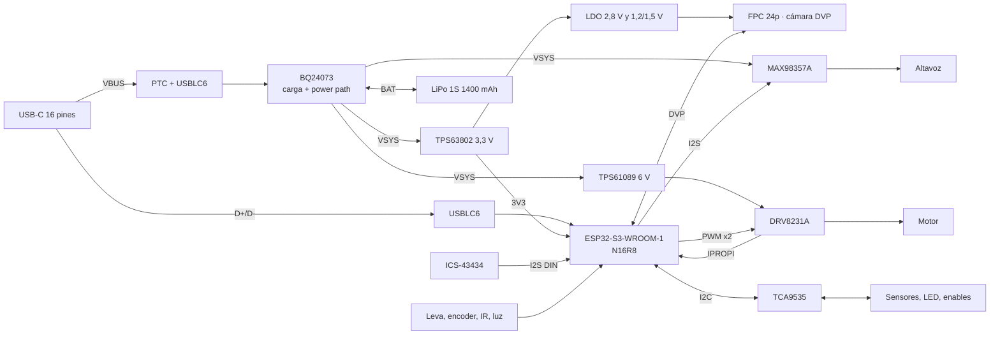

# FurbyBoard v1.0: arquitectura electrónica (fase 1)

La **FurbyBoard** es la placa que sustituye a la Raspberry Pi, al HAT WM8960 y al L298N del README. Va sobre la PCB con forma de suelo de este directorio (`NOTAS.md`, `interfaz-base.md`, `geometria.json`). Este documento es la propuesta de la fase 1. El esquemático y el layout son de la fase 2, en un proyecto KiCad llamado `FurbyBoard.kicad_pro`.

Convenciones:

- **Verificado:** comprobado en la hoja de datos, en el esquema del fabricante, en la API de piezas de JLCPCB o en la geometría del repo.
- **Estimado:** cálculo o valor típico sin medir.
- **Por medir:** hay que medirlo en el Furby o en el banco.
- Precios en USD por unidad en el tramo de 1 a 49 uds, con el stock de la API de JLCPCB del 2026-10-24.

## Decisiones tomadas

| Fecha | Decisión |
|-------|----------|
| 2026-10-24 | MCU: **módulo ESP32-S3-WROOM-1 montado por JLCPCB** en la placa. Se descartan el ESP32-S3 Zero, el S3 SuperMini y el C6 SuperMini (sección 2) |
| 2026-10-24 | **Cámara DVP** con conector FPC de 24 pines a 0,5 mm (OV2640, OV3660 u OV5640) |
| 2026-10-24 | Los GPIO que no use el Furby quedan **accesibles**, porque la placa servirá también de placa de desarrollo |
| 2026-10-24 | **LED** de alimentación, carga, programación y estado; **puntos de test** en carriles y señales clave; borrador de plan de pruebas en `TEST-PLAN.md` |
| 2026-10-24 | Nombre: **FurbyBoard**, serigrafiado con la versión y la fecha |
| 2026-10-24 | **Altura de la batería: confirmado que cabe tumbada sobre la PCB** dentro del Furby. Deja de ser un riesgo |

## Resumen

| Bloque | Elección | Por qué |
|--------|----------|---------|
| MCU | **ESP32-S3-WROOM-1-N16R8** (C2913202) | 16 MB de flash y 8 MB de PSRAM octal. Más stock que el N8R8 por 0,31 USD más. USB nativo al conector trasero y 33 GPIO útiles |
| USB | **USB-C de 16 pines de montaje medio para PCB de 1,6** (TYPE-C-CB16-16P, C42418806), con **USBLC6-2SC6** | Mantiene el eje en la cara superior de la PCB (z 5,505) y el ancho de 8,94: el corte de la base no cambia. D+ y D− van a GPIO19/20 |
| Carga | **BQ24073** (power path y modo suplemento) + PTC | Si el USB no da bastante corriente, la batería aporta el resto. PGOOD y CHG sirven para la lógica y para los LED |
| 3,3 V | **TPS63802** (buck-boost de 2 A) | Mantiene 3,3 V en todo el rango de la batería (3,0–4,2 V) con 0,6 A de pico (WiFi + cámara). Un LDO caería por debajo de 3,6 V de batería |
| Motor | **TPS61089** (elevador a 6 V) + **DRV8231A** (IN/IN, regulación de corriente e IPROPI) | Inversiones frecuentes: hay que limitar la corriente. PWM a 20 kHz (sección 6) |
| Audio | **MAX98357A** en VSYS + micro I2S **ICS-43434** en una plaquita con cable; un solo bus I2S full duplex a 16 kHz | Con la cámara no quedan pines para dos buses I2S |
| Cámara | FPC 24p 0,5 (AFC01-S24FCA-00) + LDO de **2,8 V** y de **1,2 o 1,5 V** con enable; pines como el **ESP32-S3-EYE** | El ejemplo CameraWebServer funciona con el preset `CAMERA_MODEL_ESP32S3_EYE` sin tocar pines (verificado en `camera_pins.h`) |
| E/S lentas | **TCA9535** (16 E/S por I2C) en el mismo bus que el SCCB de la cámara | Sensores táctiles, inclinación, estado de carga, enables y LED de estado. Libera GPIO nativos para la cámara y el audio |
| Coste | **≈ 15,5 USD de componentes por placa** y **17 piezas extended (51 USD por pedido)**. Pedido de 5 PCB con 2 montadas: **≈ 103 USD (52 por placa)**; con 5 montadas, **≈ 150 USD (30 por placa)** | Estimado (sección 10). La cámara y la plaquita del micro van aparte |

**Riesgos principales:**

1. **Antena.** La del WROOM-1 queda a 4,90 mm de la huella de la batería, en planta, y la batería va 4,6 mm más arriba. Es menos que lo ideal. La huella admite también el **WROOM-1U** (antena externa por U.FL) como plan B, sin rehacer la PCB.
2. **Cámara.** El cable flex hasta la cara del Furby, con PCLK de hasta 20 MHz, y el pinout del FPC, que hay que comprobar con el módulo concreto.
3. **Pico de 2,9–3,2 A** con el motor bloqueado y todo lo demás a la vez: puede disparar el PCM de la batería.

## 1. Diagrama de bloques




### Carriles

| Carril | Origen | Tensión | Alimenta |
|--------|--------|---------|----------|
| VBUS | USB-C, tras el PTC | 5 V | BQ24073 (OVP 6,6 V; 28 V máx. absoluto), LED CHG y PG |
| BAT | Batería, tras su PCM | 3,0–4,2 V | BQ24073 y divisor de VBAT |
| VSYS | OUT del BQ24073 | 4,4 V con USB; VBAT − 50 mV sin USB | TPS63802, TPS61089, MAX98357A, LED IR |
| 3V3 | TPS63802 | 3,3 V, 2 A | WROOM-1, TCA9535, micro, DOVDD de la cámara, LDO de la cámara, pull-ups, LED |
| 2V8 | ME6211C28 (EN por el expansor) | 2,8 V | AVDD de la cámara |
| 1V2 o 1V5 | ME6211C12 o C15 (misma huella, EN por el expansor) | 1,2 V (OV2640) o 1,5 V (OV3660/OV5640) | DVDD de la cámara |
| 6V | TPS61089 | 5,94 V (390k/100k) | Solo el DRV8231A |

## 2. Por qué el ESP32-S3-WROOM-1 (comparativa breve)

| Criterio | ESP32-C6 SuperMini | ESP32-S3 SuperMini | ESP32-S3 Zero | **ESP32-S3-WROOM-1-N16R8** |
|----------|--------------------|--------------------|---------------|-----------------------------|
| CPU y RAM | RISC-V de 1 núcleo a 160 MHz, 512 KB de SRAM. **No admite PSRAM** | 2 núcleos a 240 MHz, 512 KB + 2 MB de PSRAM (FH4R2, el más común) | Igual (ESP32-S3FH4R2): 4 MB de flash y 2 MB de PSRAM | 2 núcleos a 240 MHz, **16 MB de flash y 8 MB de PSRAM octal** |
| Palabra de activación | ESP-SR la admite desde la v2.6 con WakeNet9s/10s (modelos reducidos, sin SIMD) | WakeNet9/10 y AFE con AEC | Igual | Igual, con margen de PSRAM para AFE + WakeNet + búferes de TLS |
| Audio por I2S y TLS | Posible, justo de RAM | Sí | Sí | Sí |
| **Cámara DVP** | **No: el C6 no tiene interfaz de cámara** | Sí (LCD_CAM), pero sin pines suficientes | Ídem | Sí, con pines |
| GPIO accesibles | 22 en el borde | ≈ 15 | 15 castellated + 11 pads inferiores | **33** (36 en el módulo menos GPIO35–37 de la PSRAM octal) |
| D+/D− accesibles | GPIO12/13 en pads interiores | No | **No** (verificado en el esquema de Waveshare) | Sí, GPIO19/20 en pads del módulo |
| Montaje | Soldado a mano | Soldado a mano | Soldado a mano (pads inferiores difíciles) | **JLCPCB** |
| Cargador propio | **Sí**, según una fuente (LTH7R, sin verificar). Chocaría con nuestro power path, así que B+ y B− se dejarían sin conectar | No | No | No |
| Precio | ≈ 3–4 € | ≈ 4 € | ≈ 5–6 € | 5,35 USD + 3 USD de cargo por pedido |

Picovoice Porcupine (el del README actual) no está verificado en ninguno de estos chips. ESP-SR y microWakeWord sí funcionan en el ESP32-S3.

**El C6 queda descartado** porque no tiene interfaz de cámara ni PSRAM. Los S3 en placa de desarrollo no tienen pines para cámara + audio + motor + sensores. El WROOM-1 es un módulo certificado, sin diseño de RF propio, y lo monta JLCPCB.

**Variante: N16R8 (C2913202)**: 27 796 en stock, 5,35 USD (3,75 a 100 uds).

- El N8R8 (C2913201) tiene 5444 en stock y cuesta 5,03 USD. El N16R8 cuesta 0,31 USD más y deja sitio para dos particiones OTA, los modelos de ESP-SR y los recursos de audio.
- **Ojo:** las variantes R8 tienen un rango de temperatura de −40 a **+65 °C** de ambiente (parámetro de JLCPCB/LCSC). Dentro del Furby y con la carga a 0,8 W no debería llegarse, pero el cargador va lejos del módulo.

## 3. Mapa de pines

**GPIO del WROOM-1:** 36 en el módulo. Con PSRAM octal no se usan GPIO35–37 (verificado). GPIO19/20 son el USB, GPIO43/44 la consola de rescate y GPIO0 el BOOT. **Quedan 28 para el Furby, y se usan los 28.** Lo lento va al TCA9535.

| GPIO | Función | Notas |
|------|---------|-------|
| 0 | BOOT | Botón a GND y 10 kΩ a 3V3. TP |
| 1 | VBAT (ADC1_CH0) | Divisor 100k/100k + 100 nF |
| 2 | Luz (ADC1_CH1) | 47 kΩ a GND + 100 nF |
| 3 | IPROPI del motor (ADC1_CH2) | Strapping de JTAG, ignorado salvo eFuse. RIPROPI lo deja bajo al arrancar. **JP3** |
| 4 | SIOD = SDA del I2C | Cámara (SCCB) + TCA9535; 4,7 kΩ a 3V3 |
| 5 | SIOC = SCL del I2C | Ídem |
| 6 | VSYNC | Cámara |
| 7 | HREF | Cámara |
| 8 | Y4 (D2) | Cámara |
| 9 | Y3 (D1) | Cámara |
| 10 | Y5 (D3) | Cámara |
| 11 | Y2 (D0) | Cámara |
| 12 | Y6 (D4) | Cámara |
| 13 | PCLK | Cámara |
| 14 | Encoder (PCNT) | Tras el 74LVC1G17. **JP4** |
| 15 | XCLK | Cámara (LEDC, 10–20 MHz) |
| 16 | Y9 (D7) | Cámara |
| 17 | Y8 (D6) | Cámara |
| 18 | Y7 (D5) | Cámara |
| 19 / 20 | USB D− / D+ | Al USB-C trasero, con USBLC6. TP |
| 21 | INT del TCA9535 | GPIO RTC: despierta del sueño profundo (ext0) al tocar la barriga, la espalda o la lengua, o al enchufar el USB |
| 35–37 | — | PSRAM octal |
| 38 | I2S BCLK | Micro y amplificador comparten BCLK y WS. TP |
| 39 | I2S WS | TP |
| 40 | I2S DOUT → MAX98357A | TP |
| 41 | I2S DIN ← micro | TP |
| 42 | Receptor IR (RMT RX) | |
| 43 | U0TXD | Consola de rescate (J_EXP y TP) y **LED PROG** |
| 44 | U0RXD | Consola de rescate (J_EXP y TP) |
| 45 | Emisor IR (RMT → AO3400A) | **Strapping VDD_SPI: tiene que estar bajo al arrancar.** Solo 100 kΩ a GND, puerta del MOSFET |
| 46 | MOT_IN2 (PWM) | **Strapping: bajo al arrancar** (con GPIO0 bajo, 46 alto es inválido). Pull-down interno del DRV y 100 kΩ. **JP2** |
| 47 | Leva (inicio) | 47 kΩ a 3V3, 1 kΩ en serie y 100 nF |
| 48 | MOT_IN1 (PWM) | 100 kΩ a GND. **JP1** |

**TCA9535** (dirección 0x20; I2C a 400 kHz):

- todos sus pines arrancan como entradas, así que las resistencias fijan el estado al encender;
- sus E/S toleran 5,5 V: lee PGOOD y CHG aunque los LED vayan a VBUS.

| Pin | Función | Estado al arrancar |
|-----|---------|--------------------|
| P0.0 | Barriga | Pull-up de 47 kΩ |
| P0.1 | Espalda | Pull-up de 47 kΩ |
| P0.2 | Lengua | Pull-up de 47 kΩ |
| P0.3 | Inclinación A | Pull-up de 47 kΩ |
| P0.4 | Inclinación B | Pull-up de 47 kΩ |
| P0.5 | PGOOD (USB presente) | LED PG a VBUS |
| P0.6 | CHG (cargando) | LED CHG a VBUS |
| P0.7 | **Libre** → J_EXP | |
| P1.0 | EN1 del BQ24073 | 100 kΩ a VSYS: 1 |
| P1.1 | EN2 del BQ24073 | 100 kΩ a GND: 0 → USB500 (475 mA). Con EN1 = 0 y EN2 = 1 pasa a ILIM (1,34 A) |
| P1.2 | EN del elevador de 6 V y LED del encoder | 100 kΩ a GND: apagado |
| P1.3 | SD_MODE del MAX98357A | Pull-down interno de 100 kΩ: apagado |
| P1.4 | PWDN de la cámara | 10 kΩ a 3V3: cámara en reposo |
| P1.5 | EN de los LDO de la cámara | 100 kΩ a GND: cámara sin alimentación |
| P1.6 | LED RUN (latido) | Sin pull-up: LED apagado |
| P1.7 | **Libre** → J_EXP | |

El RESET de la cámara va a 3V3 con una RC (10 kΩ + 100 nF). La cámara se reinicia apagando sus LDO.

### GPIO libres y por dónde salen

| Con el Furby completo | Dónde |
|-----------------------|-------|
| Expansor P0.7 y P1.7 | J_EXP, pines 7 y 8 |
| Bus I2C (GPIO4 y GPIO5), para añadir sensores | J_EXP, pines 5 y 6 |
| UART0 (GPIO43 y GPIO44) | J_EXP, pines 9 y 10, y TP |

| Liberables para usar la placa en otro proyecto | Cómo |
|------------------------------------------------|------|
| GPIO48, 46 y 3 (motor) | Cortar **JP1–JP3** (puentes de soldadura cerrados). El lado del GPIO queda en su TP. Sin el corte, el DRV8231A movería el motor |
| GPIO14 (encoder) | Cortar **JP4**: si no, el Schmitt manda en la línea |
| GPIO4–13 y 15–18 (cámara) | Sin cámara quedan libres en el **conector FPC**: con un adaptador de FPC de 24p 0,5 a 2,54 (≈ 1 €) salen a una protoboard |
| GPIO38–41 (I2S) | En sus TP. El amplificador (apagado por SD_MODE) y el micro (sin montar) no cargan la línea |
| GPIO42, 47 y 2 (IR, leva, luz) | En sus pads de cable. Solo tienen pull-ups o divisores de 47 kΩ |

Los jumpers que merecen la pena son JP1–JP4: el motor y el encoder son los únicos que **mueven o fuerzan** la línea si no se desconectan. En el audio y los sensores no hace falta: sus pines quedan en alta impedancia o con resistencias de 47 kΩ.

**J_EXP: header de 1 × 10 a 2,54, sin montar**, en el borde izquierdo y fuera de la batería:

1. GND
2. 3V3
3. VSYS
4. VBUS (5 V)
5. SDA (GPIO4)
6. SCL (GPIO5)
7. EXP P0.7
8. EXP P1.7
9. U0TX (GPIO43)
10. U0RX (GPIO44)

El número de cada pad va serigrafiado en la cara inferior: arriba, entre el header y la batería, quedan 2 mm, y no cabe texto legible. En la cara superior se marca el pin 1.

## 4. Circuitería del módulo y USB

- **Alimentación:** 22 µF + 100 nF junto al pin 3V3 del módulo. Hoja de datos del WROOM-1: 10 µF como mínimo; se pone más por los picos de 340 mA del TX.
- **EN:** 10 kΩ a 3V3 y 1 µF a GND (retardo recomendado por Espressif), botón RESET a GND y TP.
- **BOOT:** GPIO0 con 10 kΩ a 3V3, botón a GND y TP.
- **Botones:** TS-1088-AR02016 (C720477, básica, 4 × 3 mm). Con el USB nativo, `esptool` entra y sale del modo descarga sin tocarlos; solo hacen falta para recuperar la placa.
- **USB:**
  - D+ y D− (GPIO20/19) van al USB-C con el **USBLC6-2SC6** (C2687116) junto al conector, en pareja diferencial de 90 Ω. A 12 Mbit/s, los ≈ 50 mm hasta el módulo no son problema.
  - CC1 y CC2 llevan 5,1 kΩ a GND.
  - VBUS pasa por el PTC y llega al BQ24073.
  - Programación y consola por USB-Serial-JTAG. Sin cables sueltos ni puente UART.
- **Antena (verificado en planta con `render_arquitectura.py`):**
  - el WROOM-1 va con la antena en el borde delantero, centrada en x = −73;
  - debajo de la antena y 3 mm a cada lado, **sin cobre en ninguna capa, sin pistas y sin vías** (x −85 a −61, desde y −63,5 hasta el borde);
  - la antena queda a 4,90 de la huella de la batería, y la batería, 4,6 mm más arriba;
  - el módulo asoma un 55 % fuera de la batería;
  - nada metálico delante: el borde de la base es plástico y encima está la cara del Furby.

  Si en la prueba el RSSI sale más de 10 dB por debajo de un ESP32 de referencia, se monta el **WROOM-1U-N16R8** (C3013946, 33 190 en stock, 5,18 USD) con una antena flexible pegada en la cabeza. Tiene los mismos pads y es más corto.

## 5. Cámara

**Conector:** AFC01-S24FCA-00 (C262669, 27 234 en stock, 0,12 USD). 24 pines a 0,5 mm, contacto inferior y tapa abatible, como el del ESP32-CAM. Va entre el módulo y H2, con la abertura hacia delante. El flex sube en vertical por delante, hacia la cara.

**Pinout del FPC.** Es el estándar de facto de los módulos OV2640, OV3660 y OV5640 para ESP32. **Hay que verificarlo con la ficha del módulo comprado** antes de la fase 2:

| Pin | Señal | Pin | Señal | Pin | Señal |
|-----|-------|-----|-------|-----|-------|
| 1 | NC | 9 | HREF | 17 | PCLK |
| 2 | AGND | 10 | DVDD | 18 | Y6 |
| 3 | SIOD | 11 | DOVDD | 19 | Y2 |
| 4 | AVDD | 12 | Y9 | 20 | Y5 |
| 5 | SIOC | 13 | XCLK | 21 | Y3 |
| 6 | RESETB | 14 | Y8 | 22 | Y4 |
| 7 | VSYNC | 15 | DGND | 23 | Y1 |
| 8 | PWDN | 16 | Y7 | 24 | Y0 |

Y0 e Y1 no se usan: el bus es de 8 bits, de Y2 a Y9.

**Alimentación, como en el ESP32-CAM:**

- DOVDD: **3,3 V**, del carril 3V3, igual que las E/S del ESP32.
- AVDD: **2,8 V**, con ME6211C28M5G-N (C53099, 450 mA).
- DVDD: **1,2 V** para el OV2640 (ME6211C12M5G-N, C236672) o **1,5 V** para el OV3660/OV5640 (ME6211C15M5G-N, C53100). Es la misma huella SOT-23-5: se elige en la BOM. Algunos módulos OV5640 traen su propio regulador: mirar la ficha.
- Los dos LDO tienen el EN en P1.5 del expansor: con la cámara apagada no consume nada.

**Hasta la cara del Furby.** Lo más sencillo es un módulo con **flex largo** (los hay de 75 y 150 mm para ESP32). Si no llega:

- un adaptador hembra-hembra de FPC de 24p 0,5;
- y un **FFC de 24p 0,5 con contactos del mismo lado** (C6936341, 150 mm).

Con PCLK de hasta 20 MHz y solo dos masas en el cable, **conviene no pasar de 20 cm**, bajar XCLK a 10–16 MHz y usar JPEG (sección 5.1). Sitio propuesto: la ventana de la frente, donde están el sensor de luz y el IR, o la zona de la nariz. Se decide al abrir el Furby.

### 5.1 Ancho de banda de PSRAM

- **Disponible:** la PSRAM octal del WROOM-1 R8 va a 80 MHz DDR en ESP-IDF, unos 160 MB/s teóricos.
- **Cámara:** en JPEG (compresión en el sensor) en SVGA a 15 fps ≈ 0,5 MB/s; QVGA RGB565 a 15 fps ≈ 2,3 MB/s; VGA YUV a 15 fps ≈ 9 MB/s.
- **Audio:** 16 kHz × 16 bit × 2 sentidos ≈ 64 KB/s.
- **Modelos de ESP-SR:** en PSRAM.

**Holgura de un orden de magnitud o más.** El cuello de botella será el WiFi (≈ 1–2 MB/s útiles con TLS) y la CPU, no la PSRAM. Recomendación:

- la cámara en JPEG y por foto («¿qué ves?»), no vídeo continuo;
- y apagada (LDO con EN a 0) el resto del tiempo.

## 6. Motor

**Uso actual** (`hardware_control.py` con el L298N):

- IN1 e IN2 con PWM a **100 Hz y 70 %**, una entrada por sentido;
- inversiones cada **0,4 s** («pensando») y cada **1,0 s** («hablando»);
- final de carrera con pull-up, activo a nivel bajo; a partir de ahí se posiciona por tiempo.

**DRV8231A (verificado en su hoja de datos):**

| Requisito | DRV8231A |
|-----------|----------|
| Control IN/IN con PWM en las dos entradas, sin pin de dirección | Sí: 10 y 01 mueven, **11 frena** (lado bajo, decaimiento lento) y **00 deja libre** (alta impedancia) |
| Inversiones con margen | Regulación de corriente a ITRIP = 2,70 V / (1,5 kΩ × 1500 µA/A) = **1,2 A**. Al invertir en marcha, la corriente llega a (V + fcem) / R, casi el doble que la de bloqueo, y el DRV la recorta en cada ciclo (tOFF de 25 µs). Pico máximo de 3,7 A. Disipación con 1,2 A: 0,86 W → +37 °C (42,8 °C/W) |
| Protecciones | Sobrecorriente (3,7 A), térmica (150 °C), subtensión |
| Motor parado al arrancar | Pull-down internos en IN1 e IN2, más 100 kΩ externos; GPIO46 y GPIO48 arrancan bajos |

**El PWM tiene que subir a 20 kHz.** A 100 Hz con libre en el tiempo apagado, el DRV8231A **se duerme**:

- con IN1 = IN2 = 0 durante más de tSLEEP (0,8–1,5 ms) entra en reposo, y el 30 % apagado de 100 Hz son 3 ms;
- y al volver tarda tWAKE (250 µs) en reaccionar.

Por eso **PWM a 20 kHz** (LEDC con 11 bits de resolución). Además:

- queda fuera del oído, sin el zumbido de 100 Hz que capta el micro;
- usar **decaimiento lento** (una entrada a 1 y PWM invertido en la otra) da par más estable;
- al invertir: **freno de 20–30 ms y rampa de 30–50 ms**. Así el pico al invertir no llega al PCM de la batería.

**Encoder: sí, recomiendo posicionar por pulsos.** Los pads ya están, y GPIO14 (PCNT) más el Schmitt también.

- Con el final de carrera como referencia y el encoder contando, cada postura es un número de pulsos. No depende de la tensión de la batería, del desgaste ni de la carga, como el posicionamiento por tiempo.
- El encoder también detecta el bloqueo: no llegan pulsos en 150 ms con PWM aplicado. IPROPI lo confirma por corriente.

**Corriente del motor: por medir.** Estimación: 0,1–0,3 A en marcha y 0,6–1,2 A bloqueado a 6 V. Se mide la resistencia del bobinado (I ≈ 6 V / R) y se ajusta ITRIP con el divisor de VREF.

## 7. Carga, 3,3 V y audio

- **BQ24073** (C15220, 30 252 en stock, 0,88 USD):
  - RISET 1,8 kΩ → **ICHG 0,494 A**; RILIM 1,2 kΩ → 1,34 A;
  - TS con 10 kΩ, TD a GND y TMR al aire;
  - EN1 y EN2 desde el expansor, arrancando en USB500.
  - Con el buck-boost para el 3,3 V ya no importa que OUT sea fijo a 4,4 V, así que vuelve el BQ24073 (más stock y más barato que el BQ24072, y con el mismo pinout).
  - Ya no hace falta el LM66100: no hay otro USB que pueda inyectar 5 V.
- **TPS63802DLAR** (C2845237, 37 713 en stock, 0,91 USD):
  - VIN de 1,3 a 5,5 V, 2 A, 11 µA de consumo en reposo;
  - bobina FHD4020S-R47MT (C602026, 0,47 µH);
  - divisor de realimentación a 3,3 V en la fase 2.
- **TPS61089** + FHD4020S-1R0MT (la bobina del mod de la Game Boy), con RILIM de 270 kΩ (3,8 A) y RFREQ de 150 kΩ (≈ 0,96 MHz).
- **MAX98357A** en VSYS: 0,77 W en 8 Ω con 3,7 V (hoja de datos). Ahora comparte BCLK y WS con el micro (I2S0 full duplex a 16 kHz): el TTS se pide a 16 kHz o se remuestrea en el ESP32. El full duplex síncrono es lo que mejor le va a la AEC de ESP-SR.
- **ICS-43434** a 16 kHz en modo de bajo consumo (230 µA, rango de 6,25 a 18,75 kHz, verificado). Va en una plaquita con cable de ≤ 15 cm hasta el agujero del micro original.
- **Palabra de activación:** ESP-SR WakeNet10 ya admite español. Las palabras propias se pueden entrenar con el proceso de Espressif o con su TTS Pipeline. microWakeWord es la alternativa abierta.

## 8. LED

Todos con 0,6–1,5 mA. Solo LED rojos y verdes básicos de JLCPCB: KT-0603R, C2286; KT-0805G, C2297.

| LED | Color | Circuito | Corriente | Cómo se apaga | Qué indica |
|-----|-------|----------|-----------|---------------|------------|
| PWR | Verde | 3V3 → 2,2 kΩ → LED → GND | 0,6 mA | **JP_LED** (puente cerrado: cortarlo tras el bring-up) | Hay 3,3 V |
| CHG | Rojo | VBUS → 2,2 kΩ → LED → CHG del BQ | 1,45 mA, solo con USB | No gasta batería | Cargando |
| PG | Verde | VBUS → 2,2 kΩ → LED → PGOOD | 1,4 mA, solo con USB | No gasta batería | USB válido. **PG encendido y CHG apagado = cargada** (equivale al STDBY de otros cargadores, que el BQ no tiene) |
| PROG | Rojo | 3V3 → 1,5 kΩ → LED → **U0TXD (GPIO43)** | 1 mA mientras TX está bajo | Apagado en reposo: la UART en reposo está alta | Actividad del ROM y del bootloader |
| RUN | Verde | 3V3 → 1,5 kΩ → LED → P1.6 del TCA9535 | 0,9 mA | Por firmware | Latido: el programa corre |

**Por qué PROG en U0TXD:**

- En cada arranque, el ROM escribe su log por U0TXD, y lo hace también al entrar en modo descarga («waiting for download»). El LED parpadea en cada reset y al entrar a programar, sin firmware.
- GPIO43 no es strapping, y un LED hacia 3V3 no fuerza la línea a nivel bajo.
- Con USB nativo, la transferencia del firmware va por USB-Serial-JTAG y no pasa por la UART. Por eso, **«programándose» se ve como: PROG parpadea al reset y RUN se apaga** mientras dura la escritura. Ninguna línea física cambia durante la transferencia, así que no hay forma más directa.
- Descartado un LED en GPIO0: solo se encendería con el botón pulsado, y un LED a GND en ese pin podría forzar el modo descarga.

Descartado un WS2812/SK6812 para el estado: gasta **0,6 mA en reposo** (parámetro de LCSC del SK6812MINI-E) incluso apagado. Eso es más que todo lo demás de la placa dormida.

## 9. Puntos de test

Pads SMD de Ø1,5 (o los propios pads de cable), todos fuera de la batería y accesibles con ella montada.

| TP | Tensión o señal esperada | Dónde |
|----|--------------------------|-------|
| VBUS | 5,0 V ± 0,25 con USB | Grupo de potencia (derecha) |
| VBAT | 3,0–4,2 V; 4,20 V ± 0,02 al terminar la carga | Grupo de potencia |
| VSYS | 4,4 V ± 0,1 con USB; VBAT − ≈ 50 mV sin USB | Grupo de potencia |
| 3V3 | 3,30 V ± 0,1 | Grupo de potencia y J_EXP |
| 6V | 5,94 V ± 0,15 con EN; ≈ VSYS − 0,4 V con el elevador apagado (diodo del FET alto) | Grupo de potencia |
| 2V8 | 2,80 V ± 0,06 con la cámara encendida; 0 V apagada | Bloque de LDO de la cámara |
| 1V2 o 1V5 | 1,20 o 1,50 V ± 0,05 con la cámara encendida | Bloque de LDO de la cámara |
| GND | 0 V | Grupo de potencia, lóbulo, botones y J_EXP (4 en total) |
| EN | 3,3 V en marcha; 0 V con RESET pulsado | Bloque de botones |
| IO0 | 3,3 V; 0 V con BOOT pulsado | Bloque de botones |
| D+ / D− | Datos USB FS (osciloscopio: 0–3,3 V) | Junto al USBLC6 |
| CHG | 0 V cargando; ≈ VBUS − Vf sin cargar | Bloque de carga |
| PGOOD | 0 V con USB válido | Bloque de carga |
| IPROPI | 2,25 V/A × corriente del motor | Bloque del puente H |
| MOT OUT1 / OUT2 | ±6 V con PWM a 20 kHz | Pads del motor |
| SPK+ / SPK− | PWM de clase D (≈ 300 kHz), en modo diferencial | Pads del altavoz (lóbulo) |
| I2S BCLK / WS / DIN | 512 kHz / 16 kHz / datos | Pads del micro |
| I2S DOUT | Datos | TP del lóbulo |
| U0TX / U0RX | 115 200 baudios, 3,3 V | J_EXP |

## 10. BOM preliminar y coste

API de piezas de JLCPCB del 2026-10-24. Precio por unidad de 1 a 49 uds.

| Ref. | Pieza | LCSC | Tipo | Stock | USD |
|------|-------|------|------|-------|-----|
| U1 | ESP32-S3-WROOM-1-N16R8 | C2913202 | Extended | 27 796 | 5,346 |
| U2 | BQ24073RGTR | C15220 | Extended | 30 252 | 0,880 |
| U3 | TPS63802DLAR | C2845237 | Extended | 37 713 | 0,908 |
| L1 | FHD4020S-R47MT (0,47 µH) | C602026 | Extended | 2359 | 0,071 |
| U4 | TPS61089RNRR | C165129 | Extended | 10 369 | 0,715 |
| L2 | FHD4020S-1R0MT (1 µH) | C602028 | Extended | 13 988 | 0,074 |
| U5 | DRV8231ADDAR | C5218849 | Extended | 2056 | 1,055 |
| U6 | MAX98357AETE+T | C910544 | Extended | 21 765 | 1,323 |
| U7 | TCA9535PWR (TI) | C130204 | Extended | 7294 | 1,330 |
| U8 | SN74LVC1G17DBVR | C7836 | Extended | 9943 | 0,155 |
| U9 | ME6211C28M5G-N | C53099 | Extended | 30 205 | 0,066 |
| U10 | ME6211C12M5G-N (OV2640) o C15 (C53100) | C236672 | Extended | 34 518 | 0,062 |
| U11 | USBLC6-2SC6 | C2687116 | Extended | 124 155 | 0,048 |
| J1 | USB-C 16p montaje medio 1,6 (TYPE-C-CB16-16P) | C42418806 | Extended | **1200** | 0,217 |
| J2 | JST-PH 2p SMD (S2B-PH-SM4-TB) | C295747 | Extended | 27 506 | 0,223 |
| J3 | FPC 24p 0,5 (AFC01-S24FCA-00) | C262669 | Extended | 27 234 | 0,121 |
| F1 | PTC 1,5 A/16 V (BSMD1206-150-16V) | C883133 | Extended | 46 173 | 0,068 |
| Q1, Q2 | AO3400A | C20917 | Básica | 1 227 194 | 0,089 ×2 |
| SW1, SW2 | TS-1088-AR02016 | C720477 | Básica | 528 738 | 0,053 ×2 |
| D | LED KT-0603R (rojo) ×2 y KT-0805G (verde) ×3 | C2286 / C2297 | Básicas | > 2 M | ≈ 0,064 en total |
| C | 22 µF 25 V 0805 ×10, 10 µF 10 V 0603 ×6, 1 µF ×6, 100 nF ×25 | C45783 / C19702 / C15849 / C14663 | Básicas | > 4 M | ≈ 2,37 en total |
| R | ≈ 60 resistencias 0603 UNI-ROYAL (las de la iteración anterior) | | Básicas o «preferred» | | ≈ 0,15 en total |

- **Componentes: ≈ 15,5 USD por placa.**
- **17 piezas extended, a 3 USD cada una: 51 USD por pedido.**
- Fuera de la BOM: módulo de cámara (≈ 5–10 €), plaquita del micro con el ICS-43434 (C5656610, 4,60 USD) y batería.

| Pedido en JLCPCB (estimado) | 2 montadas de 5 | 5 montadas de 5 |
|-----------------------------|-----------------|-----------------|
| PCB de 2 capas, 70 × 76 | ≈ 4 | ≈ 4 |
| Montaje: preparación + plantilla | 9,5 | 9,5 |
| Cargos de extended | 51 | 51 |
| Componentes, con mínimos y merma | ≈ 39 | ≈ 85 |
| **Total sin envío ni impuestos** | **≈ 103 USD (52 por placa)** | **≈ 150 USD (30 por placa)** |

Para bajar el cargo de extended, se pueden soldar a mano el JST, el PTC y el FPC (−9 USD).

**El USB-C tiene poco stock (1200).** Segundas fuentes:

- KH-TYPE-C-CB.W-16P (C2688792): pensado para PCB de 0,8; el eje subiría 0,78 mm;
- HRO TYPE-C-31-M-12 (C165948): de superficie; el eje subiría 1,63 mm.

Las dos obligan a regenerar `geometria.json` y la base. **El HRO TYPE-C-31-M-14 queda descartado**: es de 16 pines y montaje medio, pero solo admite 1 A (plano del fabricante).

## 11. Presupuesto de potencia

Corrientes en la batería a 3,7 V, con el buck-boost a η ≈ 0,9.

| Modo | Corriente | Autonomía con 1400 mAh (85 % útil) |
|------|-----------|------------------------------------|
| Dormido: ESP32-S3 en sueño profundo (8 µA), TPS63802 (11 µA), BQ (6,5 µA), divisor VBAT (21 µA), micro (12 µA), TCA9535 (1,5 µA), PCM (≈ 5 µA) y resto (< 5 µA) | **≈ 0,09 mA** sin el LED PWR; ≈ 0,7 mA con él | Más de un año sin el LED (manda la autodescarga); ≈ 70 días con él |
| Escuchando la palabra de activación (240 MHz, WiFi en modem sleep, PSRAM activa) | ≈ 85–120 mA | **≈ 10–14 h** |
| Conversación (WiFi, audio, motor a ratos) | ≈ 200–350 mA de media | **≈ 3,5–6 h** |
| Foto con la cámara | +40–100 mA durante unos segundos (**estimado**; según el sensor) | Despreciable si es por foto |
| Motor en marcha a 6 V | 0,3 A × 6 V → 0,54 A | |
| Motor bloqueado o invirtiendo (ITRIP 1,2 A) | 2,16 A a 3,7 V; 2,42 A a 3,3 V | |
| **Pico simultáneo** (motor + TX + cámara + ampli) | 2,42 + 0,38 + 0,1 + 0,25 ≈ **3,15 A** a 3,3 V; ≈ 2,9 A a 3,7 V | |

**Con USB:**

- en USB500, el BQ completa con la batería (modo suplemento);
- con un cargador bueno (ILIM 1,34 A), la batería solo aporta en los picos del motor;
- el BQ nunca toma más de 1,5 A del USB;
- la corriente de carga es de 0,494 A (≈ 3,5 h).

El pico de unos 3 A puede disparar el PCM de la batería (≈ 3 A en un DW01 + 8205A). Lo evitan:

- la regulación a 1,2 A del DRV;
- la rampa y el freno antes de invertir;
- no arrancar el motor mientras transmite una foto.

**Temperaturas (peor caso):**

| Pieza | ΔT |
|-------|-----|
| BQ24073 cargando: (5 − 3,6) × 0,494 + (5 − 4,4) × 0,3 = 0,87 W | +39 °C |
| TPS61089 con el motor bloqueado | +27 °C |
| DRV8231A durante ≤ 200 ms | +37 °C |
| TPS63802 con 0,6 A | Pérdidas ≈ 0,2 W, repartidas |

El WROOM-1 R8 admite +65 °C de ambiente: el cargador y el elevador van al otro lado del mecanismo.

## 12. Colocación y alturas


`scripts/render_arquitectura.py` comprueba la colocación sobre `geometria.json` antes de dibujar:

- PCB, mecanismo, tornillos, USB-C, zona sin cobre de la antena y solapes;
- que la batería solo tape lo marcado como «bajo la bandeja»;
- que los TP, J_EXP, los botones y los LED queden fuera de la batería.

Pasa sin fallos.

| Elemento | Dónde | Notas |
|----------|-------|-------|
| Batería | Lado izquierdo, centro (−84,5; −91,8), −4°, sobre una bandeja | Único sitio donde cabe (búsqueda de la iteración anterior). A 1,66 de la pared y del agujero |
| WROOM-1 | x −82 a −64, y −81 a −55,5; antena hacia delante | 3,1 mm de alto: la bandeja baja a z 9,3–10,1 |
| Botones, LED PWR, PROG y RUN, TP de EN e IO0 | Entre el módulo y H2 | Accesibles |
| FPC de la cámara y LDO | Debajo de los botones, encima del mecanismo | Flex hacia delante |
| Elevador, puente H, pads del motor | A la derecha del mecanismo | Cerca de los cables del motor |
| Carga, 3,3 V, JST, ESD | Entre el mecanismo y el lóbulo | Lejos del módulo (calor) |
| TP de potencia | Grupo de 2 × 3 junto al borde derecho | VBUS, VBAT, VSYS, 3V3, 6V y GND |
| Bajo la bandeja | TCA9535, acondicionamiento, divisor de VBAT y MAX98357A | Todo de menos de 1,2 mm y sin calor apreciable |
| Pads de cables | Micro (6) delante a la derecha; IR (6) delante a la izquierda; inclinación y lengua (5) a la izquierda; leva, encoder, barriga y espalda (10) a la derecha; motor (2); luz y altavoz (4) en el lóbulo | Pasantes de Ø1,0, paso de 2,54 |
| J_EXP | 1 × 10 en el borde izquierdo, y −84 a −107 | Fuera de la batería |
| Apoyos de la bandeja | H1 y H3 atornillados, A1 (−70,5; −100) y A2 (−99; −103) apoyados | La pata mide ≈ 4,6 (de z 5,505 a 10,1). Con M2 × 8 quedan 1,8 mm de rosca en el separador, frente a los 2,4 del M2 × 4 actual: es justo. Alternativa: la pata abraza la cabeza del M2 × 4 y se sujeta con clip. Lo cierra el 3d-architect con esta planta |

**Alturas (z):**

| Elemento | z |
|----------|---|
| PCB | 3,905 a 5,505 |
| WROOM-1 | hasta 8,6 |
| Bandeja | 9,3 a 10,1 |
| **Batería** | **10,1 a 17,7** (confirmado que cabe) |
| JST-PH SMD | ≈ 11,0 (fuera de la bandeja) |
| FPC | 7,5 |
| Pared de la base | 22,0 |

**Serigrafía:**

- Cara superior: **«FurbyBoard v1.0»**, 1,0 mm de alto y 0,15 de trazo, en el borde delantero, delante de la antena (la tinta no afecta a la antena y es lo que se ve al abrir la base). También van los nombres de los TP, de los LED y de los botones, y la polaridad del JST (+/−).
- Cara inferior, que no lleva componentes: «FurbyBoard v1.0 · 2026-10» con 2 mm de alto y el **número de GPIO de cada pad de J_EXP y de los pads de cable**.
- Sin nombres de personas.

## 13. Dudas abiertas

| # | Duda | Recomendación |
|---|------|---------------|
| 1 | **Módulo de cámara concreto** (OV2640, OV3660 u OV5640), longitud de su flex y pinout del FPC | OV2640 con flex de 75–150 mm para empezar: es el más documentado con el ESP32. Verificar el pinout con su ficha antes de la fase 2 y elegir 1,2 o 1,5 V de DVDD según el sensor |
| 2 | **Dónde va la cámara en la cara** | En la ventana de la frente (sensor de luz e IR) o en la nariz. Hay que medir la distancia hasta el FPC |
| 3 | **Antena**: WROOM-1 junto a la batería, o WROOM-1U con antena externa en la cabeza | WROOM-1 en la v1.0 y medir el RSSI en el bring-up. La huella admite los dos |
| 4 | **Motor**: corriente de marcha y de bloqueo | Medir la resistencia del bobinado y ajustar ITRIP |
| 5 | **Pasar el firmware a PWM de 20 kHz** con freno y rampa, y a posicionar por encoder | Sí: a 100 Hz el DRV8231A se duerme en cada ciclo |
| 6 | **Batería**: PCM (corriente de corte), polaridad del JST y si los 50 mm incluyen el PCM | Ficha del vendedor y calibre. Con un corte por debajo de 3 A, bajar ITRIP a 0,9 A |
| 7 | **Altavoz y micro**: impedancia y sitio del micro original | Medir |
| 8 | **Sensores**: contactos de la bola de inclinación, tipo del sensor de luz y del receptor IR | Fotografiar y medir al abrir el Furby |
| 9 | **Escuchando siempre o dormido** | Dormido y despertar con un toque (INT del expansor en GPIO21); escuchando siempre solo enchufado |
| 10 | **USB-C con 1200 en stock** | Pedir con margen. Si se agota, la segunda fuente sube el eje (sección 10) |
| 11 | **Bandeja de la batería** | Encargarla al 3d-architect con la planta |

## 14. Fuentes

- Espressif:
  - ESP32-S3 Series Datasheet v2.2: consumos y strapping;
  - hoja de datos del ESP32-S3-WROOM-1/1U: GPIO35–37 con PSRAM octal, pinout, antena;
  - [README de ESP-SR](https://github.com/espressif/esp-sr): chips soportados por WakeNet y entrenamiento de palabras;
  - `camera_pins.h` del ejemplo CameraWebServer de arduino-esp32: preset ESP32-S3-EYE.
- TI: BQ2407x (SLUS810N), TPS63802, TPS61089 (SLVSD38C), DRV8231A (tSLEEP, tWAKE, tabla IN1/IN2, ITRIP, IPROPI), TCA9535.
- ADI: MAX98357A/B (SD_MODE y potencia a 3,7 V). TDK: ICS-43434.
- Planos de los USB-C: TYPE-C-CB16-16P («mid mount 1.6mm», 1,60 por encima y por debajo de la PCB), KH-TYPE-C-CB.W-16P (hundido 0,8) y HRO TYPE-C-31-M-14 (1 A).
- Waveshare: esquema del ESP32-S3-Zero (sin D+/D− accesibles).
- C6 SuperMini: [espboards.dev](https://www.espboards.dev/esp32/esp32-c6-super-mini/) (cargador LTH7R, sin verificar) y [mischianti.org](https://mischianti.org/esp32-c6-supermini-high-resolution-pinout-datasheet-schema-and-specs/).
- Furby de 1998: [Sundberg-Ferar](https://sundbergferar.com/furby-product-teardown-why-embedded-systems-engineering-and-human-centered-design-go-hand-in-hand/), [element14](https://community.element14.com/challenges-projects/design-challenges/upcycleit/b/blog/posts/upcycle-it-interactive-race-car-driver---furby-hacking), [Official Furby Wiki](https://official-furby.fandom.com/wiki/Furby_(1998)/Tilt_Sensor_Maintenance), [Instructables](https://www.instructables.com/Furby-Brain-Surgery/), [iFixit](https://www.ifixit.com/Answers/View/942382/1998+Furby+Motor+-+Gears+Seizing+()+after+jump,+anybody+know+a+fix).
- Código actual del Furby: `hardware_control.py` (PWM a 100 Hz, 70 %, inversiones y final de carrera).
- El sustituto del DC-DC U5 de la Game Boy Pocket, pedido y montado en JLCPCB: bobina FHD4020S-1R0MT y lecciones de la v1.1 (Gerber y CPL con el mismo origen, una línea de BOM por valor y rotaciones del CPL revisadas).

## Regenerar los renders

```bash
cd Hardware/PCB-suelo
.venv/bin/python -I scripts/render_arquitectura.py
```

Las posiciones de la batería, el módulo, los bloques, los pads, los TP y los apoyos son constantes al principio del script.
