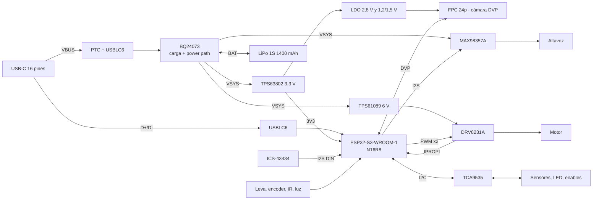
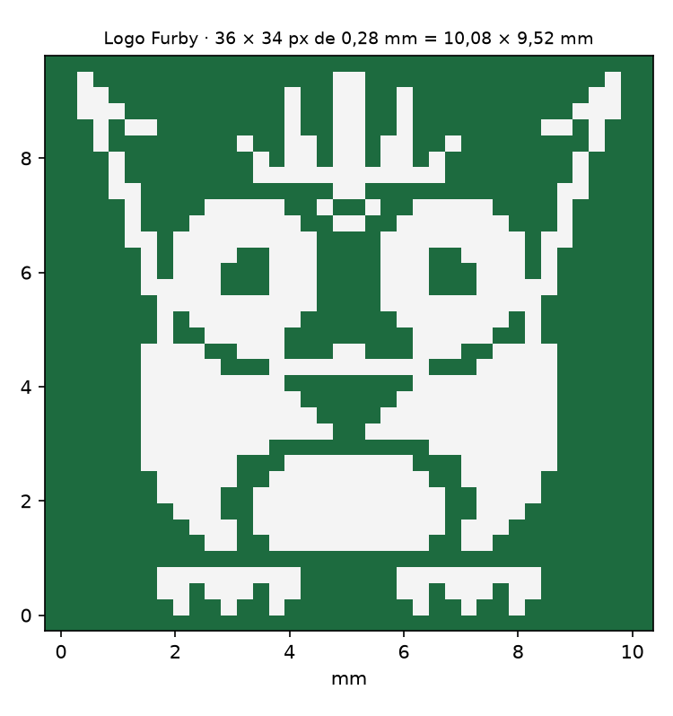

# FurbyBoard v1.0: arquitectura electrónica (fase 1, revisión v2)

La **FurbyBoard** es la placa que sustituye a la Raspberry Pi, al HAT WM8960 y al L298N del README. Va sobre la PCB con forma de suelo de este directorio (`NOTAS.md`, `interfaz-base.md`, `geometria.json`). Este documento es la propuesta de la fase 1. El esquemático y el layout son de la fase 2, en un proyecto KiCad llamado `FurbyBoard.kicad_pro`.

Convenciones:

- **Verificado:** comprobado en la hoja de datos, en el esquema del fabricante, en la API de piezas de JLCPCB o en la geometría del repo.
- **Estimado:** cálculo o valor típico sin medir.
- **Por medir:** hay que medirlo en el Furby o en el banco.
- Precios en USD por unidad en el tramo de 1 a 49 uds, con el stock de la API de JLCPCB del 2026-10-24.

## Decisiones tomadas

| Fecha | Decisión |
|-------|----------|
| 2026-10-24 | MCU: **módulo ESP32-S3-WROOM-1 montado por JLCPCB** en la placa. Se descartan el ESP32-S3 Zero, el S3 SuperMini y el C6 SuperMini (sección 2) |
| 2026-10-24 | **Cámara DVP** con conector FPC de 24 pines a 0,5 mm (OV2640, OV3660 u OV5640) |
| 2026-10-24 | Los GPIO que no use el Furby quedan **accesibles**, porque la placa servirá también de placa de desarrollo |
| 2026-10-24 | **LED** de alimentación, carga, programación y estado; **puntos de test** en carriles y señales clave; borrador del plan de pruebas en [`TEST-PLAN.md`](TEST-PLAN.md) |
| 2026-10-24 | Nombre: **FurbyBoard**, serigrafiado con la versión y la fecha |
| 2026-10-24 | **Altura de la batería: confirmado que cabe tumbada sobre la PCB** dentro del Furby. Deja de ser un riesgo. Va **directamente sobre la PCB, con calzos de espuma** y sin bandeja (sección 12) |
| 2026-10-24 | **Batería soldada a pads**, sin conector, con **protección contra la polaridad inversa** que deja cargar y descargar (sección 7.1). Los 50 mm incluyen el PCM y los cables salen por un lateral |
| 2026-10-24 | **Altavoz de 4 Ω y 3 W** (sección 7.2) |
| 2026-10-24 | **El Furby duerme y se despierta** (no escucha siempre): despierta con los interruptores (INT del TCA9535 en GPIO21) y con el temporizador (sección 11.1) |
| 2026-10-24 | **Holgura PCB-pared de 1,0 mm** (antes 0,5) como valor por defecto de `--holgura`. La posición la fijan los 4 tornillos. Se aplica al contorno en la fase 2 (sección 12.1) |
| 2026-10-24 | **Logo «Furby» en pixel art** en la serigrafía de la **cara inferior**, junto al nombre (sección 12.2) |
| 2026-10-24 | Corriente del motor: se medirá en el bobinado. Hasta entonces, la estimación y un **ITRIP ajustable** con el divisor de VREF |

## Cambios respecto a la v1

| v1 (ESP32-S3 Zero) | v2 (FurbyBoard) | Por qué |
|--------------------|-----------------|---------|
| ESP32-S3 Zero soldado a mano (4 MB de flash, 2 MB de PSRAM) | **WROOM-1-N16R8** montado por JLCPCB (16 MB de flash, 8 MB de PSRAM octal) | Decisión del 2026-10-24. Desaparecen la flash justa y las pads inferiores soldadas a mano |
| USB-C de 6 pines, solo carga; se programaba por OTA | **USB-C de 16 pines** con D+/D− a GPIO19/20 y ESD, **mismo eje y corte de la base** | El WROOM saca el USB nativo. `geometria.json` e `interfaz-base.md` no cambian; solo la huella del conector (sección 10) |
| BQ24072 + LM66100; 3,3 V con el LDO del Zero | **BQ24073 + TPS63802** (buck-boost) | Sin el USB del Zero no hay retroalimentación que bloquear (fuera el LM66100). Con el buck-boost da igual que OUT sea fijo a 4,4 V, y el BQ24073 tiene 12 veces más stock |
| Sin cámara | **Cámara DVP**, FPC de 24p y LDO de 2,8 y 1,2/1,5 V | Requisito nuevo |
| Todos los GPIO en el Zero | 28 GPIO nativos + **TCA9535** | La cámara se lleva 14 pines |
| Dos buses I2S | **Un I2S full duplex** a 16 kHz | Pines |
| Batería en bandeja impresa, JST-PH | **Calzos de espuma, pads BAT+/BAT− y P-MOSFET de polaridad** | Altura confirmada; batería soldada |
| ITRIP 1,2 A | **ITRIP 1,0 A ajustable** | El altavoz de 4 Ω sube el pico simultáneo (sección 11) |
| Sin LED, TP ni header | LED PWR, CHG, PG, PROG y RUN; TP; **J_EXP** y jumpers | Requisitos nuevos |

## Resumen

| Bloque | Elección | Por qué |
|--------|----------|---------|
| MCU | **ESP32-S3-WROOM-1-N16R8** (C2913202) | 16 MB de flash y 8 MB de PSRAM octal. Más stock que el N8R8 por 0,31 USD más. USB nativo al conector trasero y 33 GPIO útiles |
| USB | **USB-C de 16 pines de montaje medio para PCB de 1,6** (TYPE-C-CB16-16P, C42418806), con **USBLC6-2SC6** | Mantiene el eje en la cara superior de la PCB (z 5,505) y el ancho de 8,94: el corte de la base no cambia. D+ y D− van a GPIO19/20 |
| Carga | **BQ24073** (power path y modo suplemento) + PTC + **P-MOSFET SI7615ADN** contra la polaridad inversa | Si el USB no da bastante corriente, la batería aporta el resto. PGOOD y CHG sirven para la lógica y para los LED. La batería se suelda a pads y no rompe nada si se pone al revés |
| 3,3 V | **TPS63802** (buck-boost de 2 A) | Mantiene 3,3 V en todo el rango de la batería (3,0–4,2 V) con 0,6 A de pico (WiFi + cámara). Un LDO caería por debajo de 3,6 V de batería |
| Motor | **TPS61089** (elevador a 6 V) + **DRV8231A** (IN/IN, regulación de corriente e IPROPI) | Inversiones frecuentes: hay que limitar la corriente. PWM a 20 kHz (sección 6) |
| Audio | **MAX98357A** en VSYS (ganancia de 6 dB) para el altavoz de **4 Ω y 3 W** + micro I2S **ICS-43434** en una plaquita con cable; un solo bus I2S full duplex a 16 kHz | Da 0,9–1,9 W según la batería, por debajo de los 3 W del altavoz. Con la cámara no quedan pines para dos buses I2S |
| Cámara | FPC 24p 0,5 (AFC01-S24FCA-00) + LDO de **2,8 V** y de **1,2 o 1,5 V** con enable; pines como el **ESP32-S3-EYE** | El ejemplo CameraWebServer funciona con el preset `CAMERA_MODEL_ESP32S3_EYE` sin tocar pines (verificado en `camera_pins.h`) |
| E/S lentas | **TCA9535** (16 E/S por I2C) en el mismo bus que el SCCB de la cámara | Sensores táctiles, inclinación, estado de carga, enables y LED de estado. Libera GPIO nativos para la cámara y el audio |
| Coste | **≈ 15,9 USD de componentes por placa** y **17 piezas extended (51 USD por pedido)**. Pedido de 5 PCB con 2 montadas: **≈ 104 USD (52 por placa)**; con 5 montadas, **≈ 152 USD (30 por placa)** | Estimado (sección 10). La cámara y la plaquita del micro van aparte |

**Riesgos principales:**

1. **Antena.** La del WROOM-1 queda a 4,90 mm de la huella de la batería, en planta, y la batería va 4,1 mm por encima de la PCB. Es menos que lo ideal. La huella admite también el **WROOM-1U** (antena externa por U.FL) como plan B, sin rehacer la PCB.
2. **Cámara.** El cable flex hasta la cara del Furby, con PCLK de hasta 20 MHz, y el pinout del FPC, que hay que comprobar con el módulo concreto.
3. **Pico de ≈ 2,9 A** con el motor bloqueado, el WiFi, la cámara y el altavoz de 4 Ω a la vez, con ITRIP de 1,0 A y el limitador de audio (sección 11). Está en el límite del PCM de la batería.

## 1. Diagrama de bloques




### Carriles

| Carril | Origen | Tensión | Alimenta |
|--------|--------|---------|----------|
| VBUS | USB-C, tras el PTC | 5 V | BQ24073 (OVP 6,6 V; 28 V máx. absoluto), LED CHG y PG |
| BAT | Batería (pads BAT+/BAT−, tras su PCM) y P-MOSFET de polaridad | 3,0–4,2 V | BQ24073 y divisor de VBAT |
| VSYS | OUT del BQ24073 | 4,4 V con USB; VBAT − 50 mV sin USB | TPS63802, TPS61089, MAX98357A, LED IR |
| 3V3 | TPS63802 | 3,3 V, 2 A | WROOM-1, TCA9535, micro, DOVDD de la cámara, LDO de la cámara, pull-ups, LED |
| 2V8 | ME6211C28 (EN por el expansor) | 2,8 V | AVDD de la cámara |
| 1V2 o 1V5 | ME6211C12 o C15 (misma huella, EN por el expansor) | 1,2 V (OV2640) o 1,5 V (OV3660/OV5640) | DVDD de la cámara |
| 6V | TPS61089 | 5,94 V (390k/100k) | Solo el DRV8231A |

## 2. Por qué el ESP32-S3-WROOM-1 (comparativa breve)

| Criterio | ESP32-C6 SuperMini | ESP32-S3 SuperMini | ESP32-S3 Zero | **ESP32-S3-WROOM-1-N16R8** |
|----------|--------------------|--------------------|---------------|-----------------------------|
| CPU y RAM | RISC-V de 1 núcleo a 160 MHz, 512 KB de SRAM. **No admite PSRAM** | 2 núcleos a 240 MHz, 512 KB + 2 MB de PSRAM (FH4R2, el más común) | Igual (ESP32-S3FH4R2): 4 MB de flash y 2 MB de PSRAM | 2 núcleos a 240 MHz, **16 MB de flash y 8 MB de PSRAM octal** |
| Palabra de activación | ESP-SR la admite desde la v2.6 con WakeNet9s/10s (modelos reducidos, sin SIMD) | WakeNet9/10 y AFE con AEC | Igual | Igual, con margen de PSRAM para AFE + WakeNet + búferes de TLS |
| Audio por I2S y TLS | Posible, justo de RAM | Sí | Sí | Sí |
| **Cámara DVP** | **No: el C6 no tiene interfaz de cámara** | Sí (LCD_CAM), pero sin pines suficientes | Ídem | Sí, con pines |
| GPIO accesibles | 22 en el borde | ≈ 15 | 15 castellated + 11 pads inferiores | **33** (36 en el módulo menos GPIO35–37 de la PSRAM octal) |
| D+/D− accesibles | GPIO12/13 en pads interiores | No | **No** (verificado en el esquema de Waveshare) | Sí, GPIO19/20 en pads del módulo |
| Montaje | Soldado a mano | Soldado a mano | Soldado a mano (pads inferiores difíciles) | **JLCPCB** |
| Cargador propio | **Sí**, según una fuente (LTH7R, sin verificar). Chocaría con nuestro power path, así que B+ y B− se dejarían sin conectar | No | No | No |
| Precio | ≈ 3–4 € | ≈ 4 € | ≈ 5–6 € | 5,35 USD + 3 USD de cargo por pedido |

Picovoice Porcupine (el del README actual) no está verificado en ninguno de estos chips. ESP-SR y microWakeWord sí funcionan en el ESP32-S3.

**El C6 queda descartado** porque no tiene interfaz de cámara ni PSRAM. Los S3 en placa de desarrollo no tienen pines para cámara + audio + motor + sensores. El WROOM-1 es un módulo certificado, sin diseño de RF propio, y lo monta JLCPCB.

**Variante: N16R8 (C2913202)**: 27 796 en stock, 5,35 USD (3,75 a 100 uds).

- El N8R8 (C2913201) tiene 5444 en stock y cuesta 5,03 USD. El N16R8 cuesta 0,31 USD más y deja sitio para dos particiones OTA, los modelos de ESP-SR y los recursos de audio.
- **Ojo:** las variantes R8 tienen un rango de temperatura de −40 a **+65 °C** de ambiente (parámetro de JLCPCB/LCSC). Dentro del Furby y con la carga a 0,8 W no debería llegarse, pero el cargador va lejos del módulo.

## 3. Mapa de pines

**GPIO del WROOM-1:** 36 en el módulo. Con PSRAM octal no se usan GPIO35–37 (verificado). GPIO19/20 son el USB, GPIO43/44 la consola de rescate y GPIO0 el BOOT. **Quedan 28 para el Furby, y se usan los 28.** Lo lento va al TCA9535.

| GPIO | Función | Notas |
|------|---------|-------|
| 0 | BOOT | Botón a GND y 10 kΩ a 3V3. TP |
| 1 | VBAT (ADC1_CH0) | Divisor 470k/470k (C23178) + 100 nF: 4,5 µA en reposo en vez de 21 |
| 2 | Luz (ADC1_CH1) | 470 kΩ a GND + 100 nF: con luz, la LDR (≈ 10 kΩ) gasta 7 µA en vez de 60 |
| 3 | IPROPI del motor (ADC1_CH2) | Strapping de JTAG, ignorado salvo eFuse. RIPROPI lo deja bajo al arrancar. **JP3** |
| 4 | SIOD = SDA del I2C | Cámara (SCCB) + TCA9535; 4,7 kΩ a 3V3 |
| 5 | SIOC = SCL del I2C | Ídem |
| 6 | VSYNC | Cámara |
| 7 | HREF | Cámara |
| 8 | Y4 (D2) | Cámara |
| 9 | Y3 (D1) | Cámara |
| 10 | Y5 (D3) | Cámara |
| 11 | Y2 (D0) | Cámara |
| 12 | Y6 (D4) | Cámara |
| 13 | PCLK | Cámara |
| 14 | Encoder (PCNT) | Tras el 74LVC1G17. **JP4** |
| 15 | XCLK | Cámara (LEDC, 10–20 MHz) |
| 16 | Y9 (D7) | Cámara |
| 17 | Y8 (D6) | Cámara |
| 18 | Y7 (D5) | Cámara |
| 19 / 20 | USB D− / D+ | Al USB-C trasero, con USBLC6. TP |
| 21 | INT del TCA9535 | GPIO RTC: despierta del sueño profundo (ext0) al tocar la barriga, la espalda o la lengua, o al enchufar el USB |
| 35–37 | — | PSRAM octal |
| 38 | I2S BCLK | Micro y amplificador comparten BCLK y WS. TP |
| 39 | I2S WS | TP |
| 40 | I2S DOUT → MAX98357A | TP |
| 41 | I2S DIN ← micro | TP |
| 42 | Receptor IR (RMT RX) | |
| 43 | U0TXD | Consola de rescate (J_EXP y TP) y **LED PROG** |
| 44 | U0RXD | Consola de rescate (J_EXP y TP) |
| 45 | Emisor IR (RMT → AO3400A) | **Strapping VDD_SPI: tiene que estar bajo al arrancar.** Solo 100 kΩ a GND, puerta del MOSFET |
| 46 | MOT_IN2 (PWM) | **Strapping: bajo al arrancar** (con GPIO0 bajo, 46 alto es inválido). Pull-down interno del DRV y 100 kΩ. **JP2** |
| 47 | Leva (inicio) | 100 kΩ a 3V3, 1 kΩ en serie y 10 nF (τ = 1 ms). Antes de dormir, el firmware aparca la leva unos pulsos fuera del inicio para que el interruptor quede abierto |
| 48 | MOT_IN1 (PWM) | 100 kΩ a GND. **JP1** |

**TCA9535** (dirección 0x20; I2C a 400 kHz):

- todos sus pines arrancan como entradas, así que las resistencias fijan el estado al encender;
- sus E/S toleran 5,5 V: lee PGOOD y CHG aunque los LED vayan a VBUS.

| Pin | Función | Estado al arrancar |
|-----|---------|--------------------|
| P0.0 | Barriga | Pull-up de 47 kΩ |
| P0.1 | Espalda | Pull-up de 47 kΩ |
| P0.2 | Lengua | Pull-up de 47 kΩ |
| P0.3 | Inclinación A | Pull-up de 220 kΩ: si la bola queda cerrada en reposo, gasta 15 µA en vez de 70 |
| P0.4 | Inclinación B | Pull-up de 220 kΩ |
| P0.5 | PGOOD (USB presente) | LED PG a VBUS |
| P0.6 | CHG (cargando) | LED CHG a VBUS |
| P0.7 | **Libre** → J_EXP | |
| P1.0 | EN1 del BQ24073 | 100 kΩ a VSYS: 1 |
| P1.1 | EN2 del BQ24073 | 100 kΩ a GND: 0 → USB500 (475 mA). Con EN1 = 0 y EN2 = 1 pasa a ILIM (1,34 A) |
| P1.2 | EN del elevador de 6 V y LED del encoder | 100 kΩ a GND: apagado |
| P1.3 | SD_MODE del MAX98357A | Pull-down interno de 100 kΩ: apagado |
| P1.4 | PWDN de la cámara | 10 kΩ a 3V3: cámara en reposo |
| P1.5 | EN de los LDO de la cámara | 100 kΩ a GND: cámara sin alimentación |
| P1.6 | LED RUN (latido) | Sin pull-up: LED apagado |
| P1.7 | Alimentación del receptor IR (VS1838B o similar, ≈ 1 mA) | Sin pull-up: apagado. Se enciende solo despierto |

El RESET de la cámara va a 3V3 con una RC (10 kΩ + 100 nF). La cámara se reinicia apagando sus LDO.

### GPIO libres y por dónde salen

| Con el Furby completo | Dónde |
|-----------------------|-------|
| Expansor P0.7 | J_EXP, pin 7 |
| Bus I2C (GPIO4 y GPIO5), para añadir sensores | J_EXP, pines 5 y 6 |
| UART0 (GPIO43 y GPIO44) | J_EXP, pines 9 y 10, y TP |

| Liberables para usar la placa en otro proyecto | Cómo |
|------------------------------------------------|------|
| GPIO48, 46 y 3 (motor) | Cortar **JP1–JP3** (puentes de soldadura cerrados). El lado del GPIO queda en su TP. Sin el corte, el DRV8231A movería el motor |
| GPIO14 (encoder) | Cortar **JP4**: si no, el Schmitt manda en la línea |
| GPIO4–13 y 15–18 (cámara) | Sin cámara quedan libres en el **conector FPC**: con un adaptador de FPC de 24p 0,5 a 2,54 (≈ 1 €) salen a una protoboard |
| GPIO38–41 (I2S) | En sus TP. El amplificador (apagado por SD_MODE) y el micro (sin montar) no cargan la línea |
| GPIO42, 47 y 2 (IR, leva, luz) | En sus pads de cable. Solo tienen pull-ups o divisores de 100–470 kΩ |

Los jumpers que merecen la pena son JP1–JP4: el motor y el encoder son los únicos que **mueven o fuerzan** la línea si no se desconectan. En el audio y los sensores no hace falta: sus pines quedan en alta impedancia o con resistencias de 47 kΩ.

**J_EXP: header de 1 × 10 a 2,54, sin montar**, en el borde izquierdo y fuera de la batería:

1. GND
2. 3V3
3. VSYS
4. VBUS (5 V)
5. SDA (GPIO4)
6. SCL (GPIO5)
7. EXP P0.7
8. GND
9. U0TX (GPIO43)
10. U0RX (GPIO44)

El número de cada pad va serigrafiado en la cara inferior: arriba, entre el header y la batería, quedan 2 mm, y no cabe texto legible. En la cara superior se marca el pin 1.

## 4. Circuitería del módulo y USB

- **Alimentación:** 22 µF + 100 nF junto al pin 3V3 del módulo. Hoja de datos del WROOM-1: 10 µF como mínimo; se pone más por los picos de 340 mA del TX.
- **EN:** 10 kΩ a 3V3 y 1 µF a GND (retardo recomendado por Espressif), botón RESET a GND y TP.
- **BOOT:** GPIO0 con 10 kΩ a 3V3, botón a GND y TP.
- **Botones:** TS-1088-AR02016 (C720477, básica, 4 × 3 mm). Con el USB nativo, `esptool` entra y sale del modo descarga sin tocarlos; solo hacen falta para recuperar la placa.
- **USB:**
  - D+ y D− (GPIO20/19) van al USB-C con el **USBLC6-2SC6** (C2687116) junto al conector, en pareja diferencial de 90 Ω. A 12 Mbit/s, los ≈ 50 mm hasta el módulo no son problema.
  - CC1 y CC2 llevan 5,1 kΩ a GND.
  - VBUS pasa por el PTC y llega al BQ24073.
  - Programación y consola por USB-Serial-JTAG. Sin cables sueltos ni puente UART.
- **Antena (verificado en planta con `render_arquitectura.py`):**
  - el WROOM-1 va con la antena en el borde delantero, centrada en x = −73;
  - debajo de la antena y 3 mm a cada lado, **sin cobre en ninguna capa, sin pistas y sin vías** (x −85 a −61, desde y −63,5 hasta el borde);
  - la antena queda a 4,90 de la huella de la batería, y la batería, 4,6 mm más arriba;
  - el módulo asoma un 55 % fuera de la batería;
  - nada metálico delante: el borde de la base es plástico y encima está la cara del Furby.

  Si en la prueba el RSSI sale más de 10 dB por debajo de un ESP32 de referencia, se monta el **WROOM-1U-N16R8** (C3013946, 33 190 en stock, 5,18 USD) con una antena flexible pegada en la cabeza. Tiene los mismos pads y es más corto.

## 5. Cámara

**Conector:** AFC01-S24FCA-00 (C262669, 27 234 en stock, 0,12 USD). 24 pines a 0,5 mm, contacto inferior y tapa abatible, como el del ESP32-CAM. Va entre el módulo y H2, con la abertura hacia delante. El flex sube en vertical por delante, hacia la cara.

**Pinout del FPC.** Es el estándar de facto de los módulos OV2640, OV3660 y OV5640 para ESP32. **Hay que verificarlo con la ficha del módulo comprado** antes de la fase 2:

| Pin | Señal | Pin | Señal | Pin | Señal |
|-----|-------|-----|-------|-----|-------|
| 1 | NC | 9 | HREF | 17 | PCLK |
| 2 | AGND | 10 | DVDD | 18 | Y6 |
| 3 | SIOD | 11 | DOVDD | 19 | Y2 |
| 4 | AVDD | 12 | Y9 | 20 | Y5 |
| 5 | SIOC | 13 | XCLK | 21 | Y3 |
| 6 | RESETB | 14 | Y8 | 22 | Y4 |
| 7 | VSYNC | 15 | DGND | 23 | Y1 |
| 8 | PWDN | 16 | Y7 | 24 | Y0 |

Y0 e Y1 no se usan: el bus es de 8 bits, de Y2 a Y9.

**Alimentación, como en el ESP32-CAM:**

- DOVDD: **3,3 V**, del carril 3V3, igual que las E/S del ESP32.
- AVDD: **2,8 V**, con ME6211C28M5G-N (C53099, 450 mA).
- DVDD: **1,2 V** para el OV2640 (ME6211C12M5G-N, C236672) o **1,5 V** para el OV3660/OV5640 (ME6211C15M5G-N, C53100). Es la misma huella SOT-23-5: se elige en la BOM. Algunos módulos OV5640 traen su propio regulador: mirar la ficha.
- Los dos LDO tienen el EN en P1.5 del expansor: con la cámara apagada no consume nada.

**Hasta la cara del Furby.** Lo más sencillo es un módulo con **flex largo** (los hay de 75 y 150 mm para ESP32). Si no llega:

- un adaptador hembra-hembra de FPC de 24p 0,5;
- y un **FFC de 24p 0,5 con contactos del mismo lado** (C6936341, 150 mm).

Con PCLK de hasta 20 MHz y solo dos masas en el cable, **conviene no pasar de 20 cm**, bajar XCLK a 10–16 MHz y usar JPEG (sección 5.1). Sitio propuesto: la ventana de la frente, donde están el sensor de luz y el IR, o la zona de la nariz. Se decide al abrir el Furby.

### 5.1 Ancho de banda de PSRAM

- **Disponible:** la PSRAM octal del WROOM-1 R8 va a 80 MHz DDR en ESP-IDF, unos 160 MB/s teóricos.
- **Cámara:** en JPEG (compresión en el sensor) en SVGA a 15 fps ≈ 0,5 MB/s; QVGA RGB565 a 15 fps ≈ 2,3 MB/s; VGA YUV a 15 fps ≈ 9 MB/s.
- **Audio:** 16 kHz × 16 bit × 2 sentidos ≈ 64 KB/s.
- **Modelos de ESP-SR:** en PSRAM.

**Holgura de un orden de magnitud o más.** El cuello de botella será el WiFi (≈ 1–2 MB/s útiles con TLS) y la CPU, no la PSRAM. Recomendación:

- la cámara en JPEG y por foto («¿qué ves?»), no vídeo continuo;
- y apagada (LDO con EN a 0) el resto del tiempo.

## 6. Motor

**Uso actual** (`hardware_control.py` con el L298N):

- IN1 e IN2 con PWM a **100 Hz y 70 %**, una entrada por sentido;
- inversiones cada **0,4 s** («pensando») y cada **1,0 s** («hablando»);
- final de carrera con pull-up, activo a nivel bajo; a partir de ahí se posiciona por tiempo.

**DRV8231A (verificado en su hoja de datos):**

| Requisito | DRV8231A |
|-----------|----------|
| Control IN/IN con PWM en las dos entradas, sin pin de dirección | Sí: 10 y 01 mueven, **11 frena** (lado bajo, decaimiento lento) y **00 deja libre** (alta impedancia) |
| Inversiones con margen | Regulación de corriente a ITRIP = VREF / (RIPROPI × 1500 µA/A). Con RIPROPI 1,5 kΩ y VREF = 3,3 × 10k / (4,7k + 10k) = 2,245 V → **1,0 A**. **Ajustable**: con el bobinado medido, se cambia la resistencia de arriba del divisor (2,2 kΩ → 1,2 A; 6,8 kΩ → 0,87 A). Al invertir en marcha, la corriente llega a (V + fcem) / R, casi el doble que la de bloqueo, y el DRV la recorta en cada ciclo (tOFF de 25 µs). Pico máximo de 3,7 A. Disipación con 1,0 A: 0,6 W → +26 °C (42,8 °C/W) |
| Protecciones | Sobrecorriente (3,7 A), térmica (150 °C), subtensión |
| Motor parado al arrancar | Pull-down internos en IN1 e IN2, más 100 kΩ externos; GPIO46 y GPIO48 arrancan bajos |

**El PWM tiene que subir a 20 kHz.** A 100 Hz con libre en el tiempo apagado, el DRV8231A **se duerme**:

- con IN1 = IN2 = 0 durante más de tSLEEP (0,8–1,5 ms) entra en reposo, y el 30 % apagado de 100 Hz son 3 ms;
- y al volver tarda tWAKE (250 µs) en reaccionar.

Por eso **PWM a 20 kHz** (LEDC con 11 bits de resolución). Además:

- queda fuera del oído, sin el zumbido de 100 Hz que capta el micro;
- usar **decaimiento lento** (una entrada a 1 y PWM invertido en la otra) da par más estable;
- al invertir: **freno de 20–30 ms y rampa de 30–50 ms**. Así el pico al invertir no llega al PCM de la batería.

**Encoder: sí, recomiendo posicionar por pulsos.** Los pads ya están, y GPIO14 (PCNT) más el Schmitt también.

- Con el final de carrera como referencia y el encoder contando, cada postura es un número de pulsos. No depende de la tensión de la batería, del desgaste ni de la carga, como el posicionamiento por tiempo.
- El encoder también detecta el bloqueo: no llegan pulsos en 150 ms con PWM aplicado. IPROPI lo confirma por corriente.

**Corriente del motor: pendiente de medir el bobinado.** Hasta entonces, la estimación: 0,1–0,3 A en marcha y 0,6–1,2 A bloqueado a 6 V. Con la resistencia del bobinado (I ≈ 6 V / R) se ajusta ITRIP con el divisor de VREF. Si el motor bloqueado no llega a 1,0 A, la regulación no actúa y no hace falta tocar nada.

## 7. Carga, 3,3 V y audio

- **BQ24073** (C15220, 30 252 en stock, 0,88 USD):
  - RISET 1,8 kΩ → **ICHG 0,494 A**; RILIM 1,2 kΩ → 1,34 A;
  - TS con 10 kΩ, TD a GND y TMR al aire;
  - EN1 y EN2 desde el expansor, arrancando en USB500.
  - Con el buck-boost para el 3,3 V ya no importa que OUT sea fijo a 4,4 V, así que vuelve el BQ24073 (más stock y más barato que el BQ24072, y con el mismo pinout).
  - Ya no hace falta el LM66100: no hay otro USB que pueda inyectar 5 V.
- **TPS63802DLAR** (C2845237, 37 713 en stock, 0,91 USD):
  - VIN de 1,3 a 5,5 V, 2 A, 11 µA de consumo en reposo;
  - bobina FHD4020S-R47MT (C602026, 0,47 µH);
  - divisor de realimentación a 3,3 V en la fase 2.
- **TPS61089** + FHD4020S-1R0MT (la bobina del mod de la Game Boy), con RILIM de 270 kΩ (3,8 A) y RFREQ de 150 kΩ (≈ 0,96 MHz).
- **MAX98357A** en VSYS, para el altavoz de 4 Ω (sección 7.2). Ahora comparte BCLK y WS con el micro (I2S0 full duplex a 16 kHz): el TTS se pide a 16 kHz o se remuestrea en el ESP32. El full duplex síncrono es lo que mejor le va a la AEC de ESP-SR.
- **ICS-43434** a 16 kHz en modo de bajo consumo (230 µA, rango de 6,25 a 18,75 kHz, verificado). Va en una plaquita con cable de ≤ 15 cm hasta el agujero del micro original.
- **Palabra de activación:** ESP-SR WakeNet10 ya admite español. Las palabras propias se pueden entrenar con el proceso de Espressif o con su TTS Pipeline. microWakeWord es la alternativa abierta.

### 7.1 Batería a pads y protección contra la polaridad inversa

**Circuito: P-MOSFET en el lado alto con la puerta a GND.**

- Drenador al pad BAT+, fuente al nodo BAT del BQ24073 y puerta a GND por 10 kΩ.
- Pieza: **Vishay SI7615ADN** (C553966, 30 000 en stock, 0,60 USD, PowerPAK 1212-8). Hoja de datos: −20 V; RDS(on) máxima de **9,8 mΩ con VGS = −2,5 V** y 6,0 mΩ con −4,5 V; VGS(th) de −0,4 a **−1,5 V**; VGS de ±12 V; RthJA de 81 °C/W.

**Con la batería bien puesta:**

- Al conectar, el diodo interno conduce; la fuente sube y el FET entra en conducción con VGS = −VBAT.
- El canal conduce en los dos sentidos, así que la batería carga y descarga con normalidad.
- Peor caso, a 3,0 V (VGS = −3,0 V, más que los −2,5 V de la RDS especificada): **9,8 mΩ**.
  - Pico de 3,3 A: 32 mV y 0,11 W.
  - Media de 0,3 A: 3 mV y 1 mW.
  - Carga a 0,494 A: 5 mV. No afecta a la terminación del BQ.

**Con la batería al revés y sin USB:**

- El diodo interno queda en inversa y VGS ≈ 0 V: el FET está cortado.
- El nodo BAT y todo lo de la placa quedan a 0 V. **No llega tensión negativa a nada**: ni al BQ (su pin BAT admite −0,3 V como máximo absoluto), ni al divisor del ADC, ni al resto.
- Corriente: solo la fuga del FET (µA).

**Con la batería al revés y el USB enchufado (el caso delicado):**

- El BQ ve el nodo BAT por debajo de VBAT(SC) (de 1,6 a 2,0 V) y solo inyecta la corriente de detección de cortocircuito (4–11 mA, hoja de datos).
- El nodo BAT sube hasta que el FET empieza a conducir con VGS ≈ VGS(th), como mucho 1,5 V. Ahí se queda.
- Como 1,5 V < 1,6 V, el BQ **no sale de la detección de cortocircuito ni pasa a precarga**.
- Disipación: (1,5 + 4,2) V × 11 mA = 63 mW, nada. La batería se descarga a ≈ 10 mA mientras el USB siga enchufado, hasta que la protección de la batería corte.
- Si por tolerancias el BQ llegara a precarga (49 mA con RISET 1,8 kΩ), el FET disiparía ≈ 0,28 W (+23 °C) durante el temporizador de precarga (30 min) y el BQ marcaría fallo. Tampoco rompe nada.

**Descartadas:**

- N-MOSFET en el lado bajo: misma pega con el USB, y además separa GND de BAT−.
- Diodo Schottky: solo deja pasar en un sentido, así que no se podría cargar.
- Fusible + diodo en paralelo inverso: destruye el fusible en cada error.

**Pads (se marcan en `render/planta-arquitectura.png`):**

- **BAT+** cuadrado de 3 × 3 y **BAT−** redondo de Ø2,6, pasantes de Ø1,2 y Ø1,0. Separados 5,5 mm entre centros.
- Junto al cargador, a la derecha y detrás de la batería: BAT+ en (−54,5; −116,4) y BAT− en (−49,0; −116,4).
- Serigrafía «BAT+» y «BAT−» de **2,0 mm** de alto, con un «+» y un «−» de 3 mm junto a cada pad.
- Los cables salen por un lateral de la batería. **Se monta con el lado de los cables hacia detrás y a la derecha** (hacia el cargador). Así cada cable baja por los 4,1 mm que quedan bajo la batería y llega a su pad sin cruzarse.
- Dos agujeros de Ø1,2 junto a los pads, para atar los cables con hilo o una brida fina y que el tirón no vaya a la soldadura.

### 7.2 Altavoz de 4 Ω y 3 W

Potencia del MAX98357A sobre 4 Ω:

- Hoja de datos: 2,5 W al 1 % de THD y 3,2 W al 10 %, con 5 V.
- Escalando con V², que con 8 Ω da los 0,77 W a 3,7 V que trae la hoja de datos:

| VSYS | Potencia (1 % THD) |
|------|--------------------|
| 4,4 V (con USB) | ≈ 1,9 W |
| 4,2 V | ≈ 1,8 W |
| 3,7 V | ≈ 1,4 W |
| 3,0 V | ≈ 0,9 W |

**Estimado.** **Nunca llega a los 3 W del altavoz**, así que no hace falta protegerlo.

**Corriente:**

- con 1,4 W en continua, 1,4 / (0,85 × 3,7) ≈ **0,44 A de media**;
- picos de ≈ 0,9 A en las crestas.

**Otro carril (elevador de 5 V): no compensa.** Pasaría de 1,4 a 2,5 W, a cambio de otro convertidor y de picos de ≈ 1 A más en la batería. Para la voz de un Furby, 1–1,5 W ya es mucho.

**Configuración:**

- **GAIN_SLOT a VDD (6 dB)** en lugar de 9 dB: con 9 dB la escala completa ya satura a 3,7 V;
- en el firmware, un **limitador a −6 dBFS**, que deja ≈ 0,4 W de pico y **≈ 0,4 A de pico de alimentación**;
- 2 × 22 µF junto al VDD del amplificador.

## 8. LED

Todos con 0,6–1,5 mA. Solo LED rojos y verdes básicos de JLCPCB: KT-0603R, C2286; KT-0805G, C2297.

| LED | Color | Circuito | Corriente | Cómo se apaga | Qué indica |
|-----|-------|----------|-----------|---------------|------------|
| PWR | Verde | 3V3 → 2,2 kΩ → LED → GND | 0,6 mA | **JP_LED** (puente cerrado: cortarlo tras el bring-up) | Hay 3,3 V |
| CHG | Rojo | VBUS → 2,2 kΩ → LED → CHG del BQ | 1,45 mA, solo con USB | No gasta batería | Cargando |
| PG | Verde | VBUS → 2,2 kΩ → LED → PGOOD | 1,4 mA, solo con USB | No gasta batería | USB válido. **PG encendido y CHG apagado = cargada** (equivale al STDBY de otros cargadores, que el BQ no tiene) |
| PROG | Rojo | 3V3 → 1,5 kΩ → LED → **U0TXD (GPIO43)** | 1 mA mientras TX está bajo | Apagado en reposo: la UART en reposo está alta | Actividad del ROM y del bootloader |
| RUN | Verde | 3V3 → 1,5 kΩ → LED → P1.6 del TCA9535 | 0,9 mA | Por firmware | Latido: el programa corre |

**Por qué PROG en U0TXD:**

- En cada arranque, el ROM escribe su log por U0TXD, y lo hace también al entrar en modo descarga («waiting for download»). El LED parpadea en cada reset y al entrar a programar, sin firmware.
- GPIO43 no es strapping, y un LED hacia 3V3 no fuerza la línea a nivel bajo.
- Con USB nativo, la transferencia del firmware va por USB-Serial-JTAG y no pasa por la UART. Por eso, **«programándose» se ve como: PROG parpadea al reset y RUN se apaga** mientras dura la escritura. Ninguna línea física cambia durante la transferencia, así que no hay forma más directa.
- Descartado un LED en GPIO0: solo se encendería con el botón pulsado, y un LED a GND en ese pin podría forzar el modo descarga.

Descartado un WS2812/SK6812 para el estado: gasta **0,6 mA en reposo** (parámetro de LCSC del SK6812MINI-E) incluso apagado. Eso es más que todo lo demás de la placa dormida.

## 9. Puntos de test

Pads SMD de Ø1,5 (o los propios pads de cable), todos fuera de la batería y accesibles con ella montada.

| TP | Tensión o señal esperada | Dónde |
|----|--------------------------|-------|
| VBUS | 5,0 V ± 0,25 con USB | Grupo de potencia (derecha) |
| VBAT | 3,0–4,2 V; 4,20 V ± 0,02 al terminar la carga | Grupo de potencia |
| VSYS | 4,4 V ± 0,1 con USB; VBAT − ≈ 50 mV sin USB | Grupo de potencia |
| 3V3 | 3,30 V ± 0,1 | Grupo de potencia y J_EXP |
| 6V | 5,94 V ± 0,15 con EN; ≈ VSYS − 0,4 V con el elevador apagado (diodo del FET alto) | Grupo de potencia |
| 2V8 | 2,80 V ± 0,06 con la cámara encendida; 0 V apagada | Bloque de LDO de la cámara |
| 1V2 o 1V5 | 1,20 o 1,50 V ± 0,05 con la cámara encendida | Bloque de LDO de la cámara |
| GND | 0 V | Grupo de potencia, lóbulo, botones y J_EXP (4 en total) |
| EN | 3,3 V en marcha; 0 V con RESET pulsado | Bloque de botones |
| IO0 | 3,3 V; 0 V con BOOT pulsado | Bloque de botones |
| D+ / D− | Datos USB FS (osciloscopio: 0–3,3 V) | Junto al USBLC6 |
| CHG | 0 V cargando; ≈ VBUS − Vf sin cargar | Bloque de carga |
| PGOOD | 0 V con USB válido | Bloque de carga |
| IPROPI | 2,25 V/A × corriente del motor | Bloque del puente H |
| MOT OUT1 / OUT2 | ±6 V con PWM a 20 kHz | Pads del motor |
| SPK+ / SPK− | PWM de clase D (≈ 300 kHz), en modo diferencial | Pads del altavoz (lóbulo) |
| I2S BCLK / WS / DIN | 512 kHz / 16 kHz / datos | Pads del micro |
| I2S DOUT | Datos | TP del lóbulo |
| U0TX / U0RX | 115 200 baudios, 3,3 V | J_EXP |

## 10. BOM preliminar y coste

API de piezas de JLCPCB del 2026-10-24. Precio por unidad de 1 a 49 uds.

| Ref. | Pieza | LCSC | Tipo | Stock | USD |
|------|-------|------|------|-------|-----|
| U1 | ESP32-S3-WROOM-1-N16R8 | C2913202 | Extended | 27 796 | 5,346 |
| U2 | BQ24073RGTR | C15220 | Extended | 30 252 | 0,880 |
| U3 | TPS63802DLAR | C2845237 | Extended | 37 713 | 0,908 |
| L1 | FHD4020S-R47MT (0,47 µH) | C602026 | Extended | 2359 | 0,071 |
| U4 | TPS61089RNRR | C165129 | Extended | 10 369 | 0,715 |
| L2 | FHD4020S-1R0MT (1 µH) | C602028 | Extended | 13 988 | 0,074 |
| U5 | DRV8231ADDAR | C5218849 | Extended | 2056 | 1,055 |
| U6 | MAX98357AETE+T | C910544 | Extended | 21 765 | 1,323 |
| U7 | TCA9535PWR (TI) | C130204 | Extended | 7294 | 1,330 |
| U8 | SN74LVC1G17DBVR | C7836 | Extended | 9943 | 0,155 |
| U9 | ME6211C28M5G-N | C53099 | Extended | 30 205 | 0,066 |
| U10 | ME6211C12M5G-N (OV2640) o C15 (C53100) | C236672 | Extended | 34 518 | 0,062 |
| U11 | USBLC6-2SC6 | C2687116 | Extended | 124 155 | 0,048 |
| J1 | USB-C 16p montaje medio 1,6 (TYPE-C-CB16-16P) | C42418806 | Extended | **1200** | 0,217 |
| Q3 | SI7615ADN (P-MOSFET de polaridad) | C553966 | Extended | 30 000 | 0,602 |
| J2 | Pads BAT+ (cuadrado) y BAT− (redondo), pasantes | — | Cobre | — | 0 |
| J3 | FPC 24p 0,5 (AFC01-S24FCA-00) | C262669 | Extended | 27 234 | 0,121 |
| F1 | PTC 1,5 A/16 V (BSMD1206-150-16V) | C883133 | Extended | 46 173 | 0,068 |
| Q1, Q2 | AO3400A | C20917 | Básica | 1 227 194 | 0,089 ×2 |
| SW1, SW2 | TS-1088-AR02016 | C720477 | Básica | 528 738 | 0,053 ×2 |
| D | LED KT-0603R (rojo) ×2 y KT-0805G (verde) ×3 | C2286 / C2297 | Básicas | > 2 M | ≈ 0,064 en total |
| C | 22 µF 25 V 0805 ×10, 10 µF 10 V 0603 ×6, 1 µF ×6, 100 nF ×25 | C45783 / C19702 / C15849 / C14663 | Básicas | > 4 M | ≈ 2,37 en total |
| R | ≈ 60 resistencias 0603 UNI-ROYAL (las de la iteración anterior) | | Básicas o «preferred» | | ≈ 0,15 en total |

- **Componentes: ≈ 15,9 USD por placa.**
- **17 piezas extended, a 3 USD cada una: 51 USD por pedido.**
- Fuera de la BOM: módulo de cámara (≈ 5–10 €), plaquita del micro con el ICS-43434 (C5656610, 4,60 USD) y batería.

| Pedido en JLCPCB (estimado) | 2 montadas de 5 | 5 montadas de 5 |
|-----------------------------|-----------------|-----------------|
| PCB de 2 capas, 70 × 76 | ≈ 4 | ≈ 4 |
| Montaje: preparación + plantilla | 9,5 | 9,5 |
| Cargos de extended | 51 | 51 |
| Componentes, con mínimos y merma | ≈ 40 | ≈ 88 |
| **Total sin envío ni impuestos** | **≈ 104 USD (52 por placa)** | **≈ 152 USD (30 por placa)** |

Para bajar el cargo de extended, se pueden soldar a mano el PTC y el FPC (−6 USD).

**El USB-C tiene poco stock (1200).** Segundas fuentes:

- KH-TYPE-C-CB.W-16P (C2688792): pensado para PCB de 0,8; el eje subiría 0,78 mm;
- HRO TYPE-C-31-M-12 (C165948): de superficie; el eje subiría 1,63 mm.

Las dos obligan a regenerar `geometria.json` y la base. **El HRO TYPE-C-31-M-14 queda descartado**: es de 16 pines y montaje medio, pero solo admite 1 A (plano del fabricante).

## 11. Presupuesto de potencia

Corrientes en la batería a 3,7 V, con el buck-boost a η ≈ 0,9.

| Modo | Corriente | Autonomía con 1400 mAh (85 % útil) |
|------|-----------|------------------------------------|
| **Dormido** (sueño profundo; detalle en 11.1) | **≈ 0,08 mA** (0,06–0,11) sin el LED PWR; ≈ 0,7 mA con él | Meses: manda la autodescarga de la LiPo (≈ 2–3 % al mes). Con el LED PWR, ≈ 70 días |
| Despierto escuchando (tras un toque; 240 MHz, WiFi conectado) | ≈ 85–120 mA | **≈ 10–14 h** si nunca se durmiera |
| Conversación (WiFi, audio, motor a ratos) | ≈ 200–350 mA de media | **≈ 3,5–6 h** |
| Foto con la cámara | +40–100 mA durante unos segundos (**estimado**; según el sensor) | Despreciable si es por foto |
| Motor en marcha a 6 V | 0,3 A × 6 V → 0,54 A | |
| Motor bloqueado o invirtiendo (ITRIP 1,0 A) | 1,80 A a 3,7 V; 2,02 A a 3,3 V | |
| Altavoz de 4 Ω | 0,44 A de media a 1,4 W y picos de 0,9 A; con el limitador a −6 dBFS, ≈ 0,4 A de pico | |
| **Pico simultáneo** (motor + TX + cámara + ampli) | Con limitador: 2,02 + 0,38 + 0,1 + 0,4 ≈ **2,9 A** a 3,3 V (≈ 2,6 A a 3,7 V). Sin limitador, con el ampli a 0,9 A: ≈ 3,4 A | |

### 11.1 Modo dormido

Decisión de producto: **el Furby duerme y se despierta**.

- **Despierta con:**
  - barriga, espalda, lengua e inclinación: el TCA9535 activa su INT, que va a **GPIO21 (RTC, ext0)**;
  - enchufar el USB: PGOOD entra por el TCA9535 y también activa la INT;
  - el **temporizador**, por ejemplo cada 30 min y sin WiFi, solo para medir la batería: 50 ms a 40 mA, ≈ 1 µA de media.
- **Se duerme:** tras N s sin interacción, con N ajustable en el firmware.
  - Antes de dormir, el firmware aparca la leva fuera del final de carrera.
  - Al despertar graba el audio en PSRAM mientras se reconecta al WiFi (0,3–1 s con los credenciales guardados).
- **Qué se apaga:**

  | Bloque | Cómo | Consumo dormido |
  |--------|------|-----------------|
  | Cámara | EN de sus LDO a 0 (P1.5) y PWDN a 1 | ≈ 0,1 µA (LDO apagados) |
  | Elevador de 6 V y LED del encoder | EN a 0 (P1.2) | 1 µA (TPS61089) |
  | Puente H | IN1 = IN2 = 0: reposo automático | 1 µA |
  | Amplificador | SD_MODE a 0 (P1.3) | 0,6 µA |
  | Micro | Sin reloj I2S: modo sleep | 12 µA (hoja de datos del ICS-43434) |
  | Receptor IR | Alimentación desde P1.7, a 0 | 0 |
  | LED | RUN apagado; PROG apagado (TX en reposo); CHG y PG solo con USB; **PWR con JP_LED cortado** | 0 (0,6 mA si JP_LED sigue cerrado) |
  | WiFi, CPU, PSRAM | Sueño profundo, con la RTC y ext0 activos | 8 µA del ESP32-S3 + fugas del módulo (**por medir**: ≈ 10–20 µA) |

- **Lo que queda encendido:** TPS63802, TCA9535 (mantiene sus salidas), BQ24073 y la protección de la batería.

| Consumidor en reposo | Corriente | Fuente |
|----------------------|-----------|--------|
| WROOM-1 en sueño profundo | 10–20 µA en 3V3 | Hoja de datos del ESP32-S3 (8 µA) + estimación del módulo |
| TCA9535 | 1,5 µA | Hoja de datos |
| Micro en sleep | 12 µA | Hoja de datos |
| Divisor de realimentación del TPS63802 y LDO de la cámara | ≈ 3 µA | Estimado |
| Pull-ups (inclinación cerrada a 220 kΩ, el peor caso) y LDR con luz (470 kΩ) | 0–22 µA | Calculado |
| **Total en 3V3** | **≈ 27–58 µA** | |
| TPS63802: Iq + pérdidas a carga tan baja (η ≈ 0,75) | 11 µA + 3,3 × I / (0,75 × 3,7) | Hoja de datos (Iq) y estimación (η) |
| BQ24073 sin USB (IBAT(PDWN)) | 4,3 µA típicos | Hoja de datos |
| Divisor de VBAT 470k/470k | 4,5 µA | Calculado |
| SI7615ADN, DRV8231A, TPS61089, MAX98357A | ≈ 3,6 µA | Hojas de datos (máximos) |
| Protección de la batería (DW01 típico) | ≈ 3 µA | Estimado |
| **Total en la batería** | **≈ 60–110 µA (típico ≈ 80 µA)** | |

**Autonomía según el uso** (1400 mAh, 85 % útil; despertar = 30 s escuchando a 100 mA + 60 s de conversación a 300 mA con el motor ≈ 5,8 mAh):

| Uso | Consumo al día | Autonomía |
|-----|----------------|-----------|
| 5 interacciones al día | 29 + 2 (dormido) ≈ 31 mAh | **≈ 5 semanas** |
| 20 al día | 116 + 2 ≈ 118 mAh | **≈ 10 días** |
| 100 al día | 580 + 2 ≈ 582 mAh | **≈ 2 días** |
| Escuchando siempre, como referencia | ≈ 2,4 Ah | ≈ 12 h |

Cambios en la placa por el modo dormido:

- divisor de VBAT de 470k/470k;
- LDR con 470 kΩ;
- inclinación con 220 kΩ;
- leva con 100 kΩ;
- receptor IR alimentado por P1.7 (J_EXP pierde un pin libre: el 8 pasa a GND).

**Con USB:**

- en USB500, el BQ completa con la batería (modo suplemento);
- con un cargador bueno (ILIM 1,34 A), la batería solo aporta en los picos del motor;
- el BQ nunca toma más de 1,5 A del USB;
- la corriente de carga es de 0,494 A (≈ 3,5 h).

El pico de unos 3 A puede disparar el PCM de la batería (≈ 3 A en un DW01 + 8205A). Lo evitan:

- la regulación a 1,0 A del DRV;
- el limitador de audio a −6 dBFS;
- la rampa y el freno antes de invertir;
- no arrancar el motor mientras transmite una foto.

**Temperaturas (peor caso):**

| Pieza | ΔT |
|-------|-----|
| BQ24073 cargando: (5 − 3,6) × 0,494 + (5 − 4,4) × 0,3 = 0,87 W | +39 °C |
| TPS61089 con el motor bloqueado | +27 °C |
| DRV8231A durante ≤ 200 ms | +37 °C |
| TPS63802 con 0,6 A | Pérdidas ≈ 0,2 W, repartidas |

El WROOM-1 R8 admite +65 °C de ambiente: el cargador y el elevador van al otro lado del mecanismo.

## 12. Colocación y alturas


`scripts/render_arquitectura.py` comprueba la colocación sobre `geometria.json` antes de dibujar:

- PCB, mecanismo, tornillos, USB-C, zona sin cobre de la antena y solapes;
- que la batería solo tape lo marcado como «bajo la batería»;
- que los TP, J_EXP, los botones y los LED queden fuera de la batería.

Pasa sin fallos.

| Elemento | Dónde | Notas |
|----------|-------|-------|
| Batería | Lado izquierdo, centro (−84,5; −91,8), −4°, **directamente sobre la PCB**: espuma adhesiva de 1,0 mm sobre el blindaje del WROOM-1 y calzos de espuma de 4,1 mm en E1 (−70,5; −100), E2 (−99; −103) y E3 (−88; −113), círculos de Ø4 sin componentes | Único sitio donde cabe (búsqueda de la iteración anterior). A 1,66 de la pared y del agujero. **Sin bandeja impresa**: menos piezas, H1 y H3 siguen con M2 × 4, y para cambiar la batería se despega. Las paredes de la base la sujetan en los lados (1,66 mm de holgura) |
| WROOM-1 | x −82 a −64, y −81 a −55,5; antena hacia delante | 3,1 mm de alto: es el apoyo más alto bajo la batería |
| Botones, LED PWR, PROG y RUN, TP de EN e IO0 | Entre el módulo y H2 | Accesibles |
| FPC de la cámara y LDO | Debajo de los botones, encima del mecanismo | Flex hacia delante |
| Elevador, puente H, pads del motor | A la derecha del mecanismo | Cerca de los cables del motor |
| Carga, P-MOSFET de polaridad, 3,3 V, ESD | Entre el mecanismo y el lóbulo | Lejos del módulo (calor) |
| Pads BAT+ y BAT− | (−54,5; −116,4) y (−49,0; −116,4) | Lado de los cables de la batería hacia detrás y a la derecha |
| TP de potencia | Grupo de 2 × 3 junto al borde derecho | VBUS, VBAT, VSYS, 3V3, 6V y GND |
| Bajo la batería | TCA9535, acondicionamiento, divisor de VBAT y MAX98357A | Todo de menos de 1,2 mm y sin calor apreciable (el ampli con 4 Ω pierde ≈ 0,2 W en los picos) |
| Pads de cables | Micro (6) delante a la derecha; IR (6) delante a la izquierda; inclinación y lengua (5) a la izquierda; leva, encoder, barriga y espalda (10) a la derecha; motor (2); luz y altavoz (4) en el lóbulo | Pasantes de Ø1,0, paso de 2,54 |
| J_EXP | 1 × 10 en el borde izquierdo, x −104,5, y −84 a −107 | Fuera de la batería |
| Calzos de la batería | E1, E2 y E3 (espuma de 4,1) + blindaje del WROOM-1 (espuma de 1,0) | Espuma adhesiva por las dos caras (tipo VHB o EVA), sobre zonas sin componentes ni vías expuestas |

### 12.1 Holgura PCB-pared de 1,0 mm (decidido; se aplica al contorno en la fase 2)

Se comprobó regenerando el contorno con `contorno_suelo.py --holgura 1.0` en una copia fuera del repo, con el DXF del suelo y `test_contorno.py` adaptado. Pasan todos los tests.

| Consecuencia | Con 0,5 (actual) | Con 1,0 | Qué hacer |
|--------------|------------------|---------|-----------|
| Holgura a la pared | 0,500 mín. / 0,697 máx. | **1,000 / 1,199** | — |
| Área de la PCB | 4248 mm² | **4129 mm²** (−119) | Ninguna: todos los bloques, pads, TP y J_EXP siguen cabiendo (el render se comprobó también con el contorno de 1,0 tras mover hacia dentro, 0,5 mm, los pads de los bordes) |
| Borde de los taladros | H1 3,52 · H2 3,58 · H3 2,55 · H4 2,59 | H1 3,02 · H2 3,08 · **H3 2,05 · H4 2,09** | **Mover H3 a (−86,7; −121,9) y H4 a (−60,3; −121,9)**, simétricos respecto a x −73,5: quedan a 2,56 y 2,60. H1 y H2 no cambian. La base lee los taladros de `geometria.json` y se regenera sola. Actualizar `TALADROS_ESPERADOS` en `test_contorno.py` y `TALADROS_XY` en `contorno_suelo.py` |
| Boca del USB-C | y −128,49, a 0,30 de la pared (sale 0,20 del borde) | Con el script tal cual, la boca retrocede a 0,80 de la pared | **`USB_SALIENTE_BOCA` de 0,20 a 0,70**: la boca vuelve a y −128,49, a **0,30** de la pared (comprobado). El conector de montaje medio sobresale 0,70 del borde. Las patas delanteras de la carcasa siguen 2,1 mm por dentro del borde, y la ranura (fondo a 6,70 del nuevo borde) sigue siendo más larga que el cuerpo de 6,5. Comprobar en la fase 2 con la huella del TYPE-C-CB16-16P |
| Eje del USB-C, corte de la pared, funda | z 5,505; corte de z 1,905 a 9,255 | **Sin cambios** | — |
| Agujeros originales del suelo bajo la PCB | 1,07–1,15 por dentro del borde | 0,57–0,65 | Están tapados en la base: **bajar `AGUJERO_BAJO_PCB_MIN` de 1,0 a 0,5** en `test_contorno.py` |
| Batería | 1,66 a la pared | **Igual**: la pared no se mueve | — |
| Antena | 4,90 de la batería | Igual. El borde delantero retrocede 0,5 delante de la antena | — |
| Mecanismo | 16,52 del borde | 16,02 | — |
| `test_contorno.py` | `HOLGURA_MIN` 0,5 | **`HOLGURA_MIN` 1,0** | También `TALADROS_ESPERADOS` y `AGUJERO_BAJO_PCB_MIN` (filas de arriba) |

¿Más de 1,0 mm? **No lo recomiendo.** Con 1,0 mm, el peor caso de tolerancias (+0,2 de JLCPCB y −0,2 de FDM) deja 0,6 mm de aire, de sobra para que entre sin forzar.

- Con 1,5 mm, H3 y H4 tendrían que moverse otros 0,5 mm y se perderían ≈ 120 mm² más.
- El USB-C tendría que sobresalir 1,2 mm del borde: sus patas delanteras quedarían a 1,6 mm del canto.

**Alturas (z):**

| Elemento | z |
|----------|---|
| PCB | 3,905 a 5,505 |
| WROOM-1 | hasta 8,6 |
| Espuma sobre el WROOM-1 | 8,6 a 9,6 |
| **Batería** | **9,6 a 17,2** (confirmado que cabe) |
| FPC | 7,5 |
| Pared de la base | 22,0 |

**Serigrafía:**

- Cara superior: **«FurbyBoard v1.0»**, 1,0 mm de alto y 0,15 de trazo, en el borde delantero, delante de la antena (la tinta no afecta a la antena y es lo que se ve al abrir la base). También van los nombres de los TP, de los LED y de los botones, y la polaridad del JST (+/−).
- Cara inferior, que no lleva componentes: el **logo Furby** con «FurbyBoard» (1,6 mm de alto) y «v1.0 · 2026-10» (1,2 mm) debajo (sección 12.2), y el **número de GPIO de cada pad de J_EXP y de los pads de cable**. Los de los pads de la izquierda («P03», «P04», «P02», de 0,8 mm) van entre los pads y el logo.
- Un recuadro en blanco para escribir el número de la placa a rotulador (lo usa `TEST-PLAN.md`).
- Sin nombres de personas.

### 12.2 Logo «Furby» en pixel art (cara inferior)

**Dibujo:**

- Versión propia de **1 bit**, redibujada a partir de la referencia de color (que no está en el repo): **36 × 34 px**, simétrica.
- Lleva las orejas con el interior vacío, la cresta de cinco puntas, los ojos con anillo y pupila, el puente de las gafas y la marca de la frente, el pico en triángulo, la barriga en anillo y los pies con tres dedos.
- La matriz está versionada en `serigrafia/logo-furby-pixelart.txt`:
  - X = tinta;
  - . = sin tinta;
  - o = sin tinta, y cobre visto con `--cobre`.



**Tamaño:** píxel de **0,40 mm** → **14,4 × 13,6 mm**.

- El detalle más fino (un píxel de tinta o un hueco de un píxel) mide 0,40 mm. Más del doble del mínimo de JLCPCB para la serigrafía (0,153 mm de trazo y 0,15 de separación).
- Con 0,30 mm (10,8 × 10,2) seguiría cumpliendo; con más de 0,45 dejaría de caber en la zona elegida.

**Dónde (comprobado por `render_arquitectura.py`, recuadro morado discontinuo en la planta):**

- **Cara inferior**, x −98,0 a −82,6 e y −90,7 a −72,2, con el texto debajo del logo.
- Queda debajo de la mitad izquierda de la batería, pero en la otra cara: allí arriba solo hay pistas.
- Despejes:
  - sin pads pasantes (los pads de la izquierda están 1,5 mm más allá);
  - a más de 3 mm del separador de H1;
  - fuera del WROOM-1 y de los bloques con vías (el expansor empieza en y −91,2);
  - a más de 0,8 mm del borde con la holgura de 1,0.
- Comprobado con el contorno actual y con el de holgura 1,0.

En la fase 2, una **rule area sin vías** del tamaño del recuadro asegura que el rutado no ponga vías bajo el logo. El plano de GND de la cara inferior pasa por debajo sin problema: la tinta va sobre la máscara.

**Implementación:** `scripts/logo_furby.py` lee la matriz y escribe la huella `kicad/Furby.pretty/Logo_Furby_PixelArt.kicad_mod`, regenerable.

- Un polígono relleno en F.SilkS por cada tramo horizontal de píxeles, más un courtyard con la zona sin pads ni vías.
- La huella se coloca **en la cara inferior**: KiCad la pasa a B.SilkS y la espeja. Como el dibujo es simétrico, se lee igual desde abajo.
- `kicad-cli fp export svg` la carga sin errores.
- Cambiar el dibujo es editar el `.txt` y volver a ejecutar el script; `--pixel` cambia el tamaño.

**Segundo tono (opcional, `--cobre`):** los píxeles «o» de las **pupilas** pasan a ser pads SMD sin red ni pasta, con la máscara abierta. El cobre queda visto con el acabado de la placa:

- **HASL** (el de serie en JLCPCB): plateado y algo irregular;
- **ENIG**: dorado y liso, pero encarece el pedido (comprobarlo en el presupuesto de JLCPCB).

No lo recomiendo por defecto:

- son seis pads de 0,4–1,2 mm;
- el HASL los deja con relieve;
- y no aportan nada eléctrico.

Si se activa, el plano de GND los rodea con su separación y DRC no da error, porque son cobre sin red.

**Alternativa sin script:** el Image Converter de KiCad (Bitmap2Component) con un PNG de la matriz. Se descarta porque no es regenerable desde el repo.

## 13. Dudas abiertas

| # | Duda | Recomendación |
|---|------|---------------|
| 1 | **Módulo de cámara concreto** (OV2640, OV3660 u OV5640), longitud de su flex y pinout del FPC | OV2640 con flex de 75–150 mm para empezar: es el más documentado con el ESP32. Verificar el pinout con su ficha antes de la fase 2 y elegir 1,2 o 1,5 V de DVDD según el sensor |
| 2 | **Dónde va la cámara en la cara** | En la ventana de la frente (sensor de luz e IR) o en la nariz. Hay que medir la distancia hasta el FPC |
| 3 | **Antena**: WROOM-1 junto a la batería, o WROOM-1U con antena externa en la cabeza | WROOM-1 en la v1.0 y medir el RSSI en el bring-up. La huella admite los dos |
| 4 | **Motor**: corriente de marcha y de bloqueo | Medir el bobinado; ITRIP de 1,0 A por defecto, ajustable con una resistencia |
| 5 | **Pasar el firmware a PWM de 20 kHz** con freno y rampa, y a posicionar por encoder | Sí: a 100 Hz el DRV8231A se duerme en cada ciclo |
| 6 | **Batería**: corriente de corte del PCM. Las medidas y la salida lateral de los cables ya están confirmadas | Ficha del vendedor. Con un corte por debajo de 3 A, bajar ITRIP a 0,87 A (6,8 kΩ) y no solapar el motor con el audio fuerte |
| 7 | **Micro**: dónde estaba el original (el altavoz ya está confirmado: 4 Ω y 3 W) | Medir al abrir el Furby |
| 8 | **Sensores**: contactos de la bola de inclinación, tipo del sensor de luz y del receptor IR | Fotografiar y medir al abrir el Furby |
| 9 | **Cuánto tarda en dormirse y cada cuánto despierta el temporizador** | Decidido que duerme (sección 11.1). Propuesta: dormir tras 60 s sin interacción; temporizador cada 30 min, sin WiFi |
| 10 | **USB-C con 1200 en stock** | Pedir con margen. Si se agota, la segunda fuente sube el eje (sección 10) |
| 11 | **Calzos de la batería**: espuma o pieza impresa | Espuma adhesiva (más simple). Si se quiere poder quitar sin despegar, un marco impreso que se apoye en E1–E3 |

## 14. Fuentes

- Espressif:
  - ESP32-S3 Series Datasheet v2.2: consumos y strapping;
  - hoja de datos del ESP32-S3-WROOM-1/1U: GPIO35–37 con PSRAM octal, pinout, antena;
  - [README de ESP-SR](https://github.com/espressif/esp-sr): chips soportados por WakeNet y entrenamiento de palabras;
  - `camera_pins.h` del ejemplo CameraWebServer de arduino-esp32: preset ESP32-S3-EYE.
- TI: BQ2407x (SLUS810N), TPS63802, TPS61089 (SLVSD38C), DRV8231A (tSLEEP, tWAKE, tabla IN1/IN2, ITRIP, IPROPI), TCA9535.
- ADI: MAX98357A/B (SD_MODE y potencia a 3,7 V). TDK: ICS-43434.
- Planos de los USB-C: TYPE-C-CB16-16P («mid mount 1.6mm», 1,60 por encima y por debajo de la PCB), KH-TYPE-C-CB.W-16P (hundido 0,8) y HRO TYPE-C-31-M-14 (1 A).
- Waveshare: esquema del ESP32-S3-Zero (sin D+/D− accesibles).
- C6 SuperMini: [espboards.dev](https://www.espboards.dev/esp32/esp32-c6-super-mini/) (cargador LTH7R, sin verificar) y [mischianti.org](https://mischianti.org/esp32-c6-supermini-high-resolution-pinout-datasheet-schema-and-specs/).
- Furby de 1998: [Sundberg-Ferar](https://sundbergferar.com/furby-product-teardown-why-embedded-systems-engineering-and-human-centered-design-go-hand-in-hand/), [element14](https://community.element14.com/challenges-projects/design-challenges/upcycleit/b/blog/posts/upcycle-it-interactive-race-car-driver---furby-hacking), [Official Furby Wiki](https://official-furby.fandom.com/wiki/Furby_(1998)/Tilt_Sensor_Maintenance), [Instructables](https://www.instructables.com/Furby-Brain-Surgery/), [iFixit](https://www.ifixit.com/Answers/View/942382/1998+Furby+Motor+-+Gears+Seizing+()+after+jump,+anybody+know+a+fix).
- Código actual del Furby: `hardware_control.py` (PWM a 100 Hz, 70 %, inversiones y final de carrera).
- El sustituto del DC-DC U5 de la Game Boy Pocket, pedido y montado en JLCPCB: bobina FHD4020S-1R0MT y lecciones de la v1.1 (Gerber y CPL con el mismo origen, una línea de BOM por valor y rotaciones del CPL revisadas).

## Regenerar los renders

```bash
cd Hardware/PCB-suelo
.venv/bin/python -I scripts/render_arquitectura.py
```

Las posiciones de la batería, el módulo, los bloques, los pads, los TP y los apoyos son constantes al principio del script.
